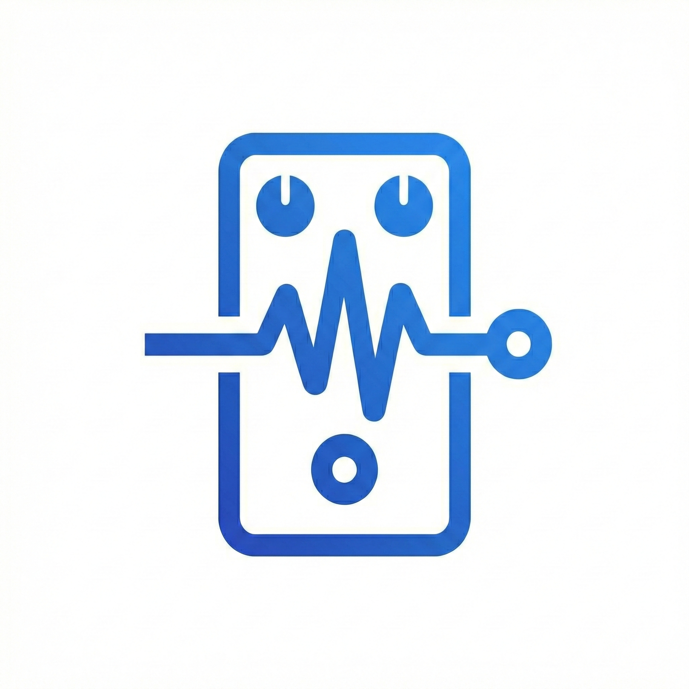
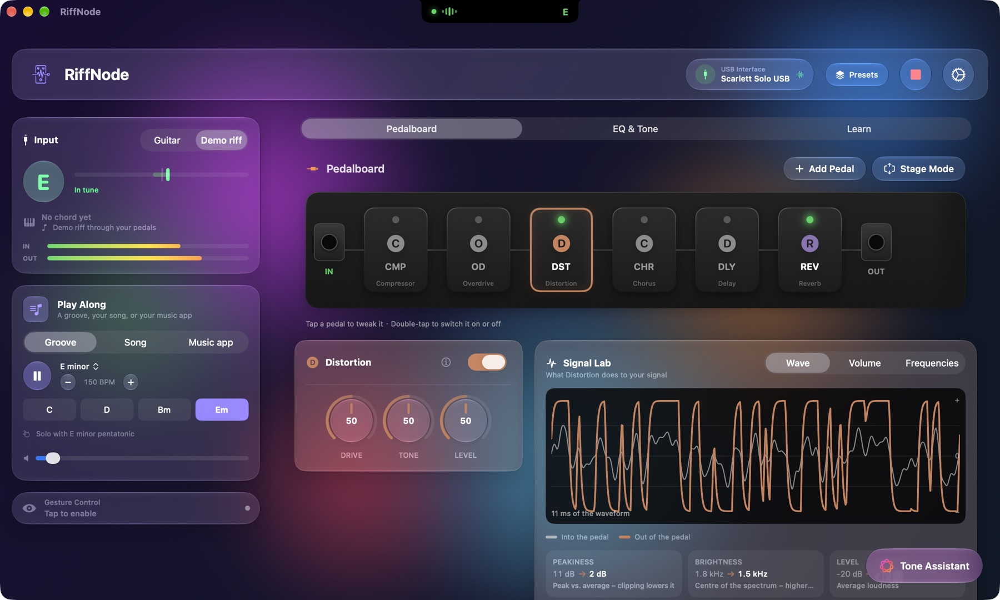
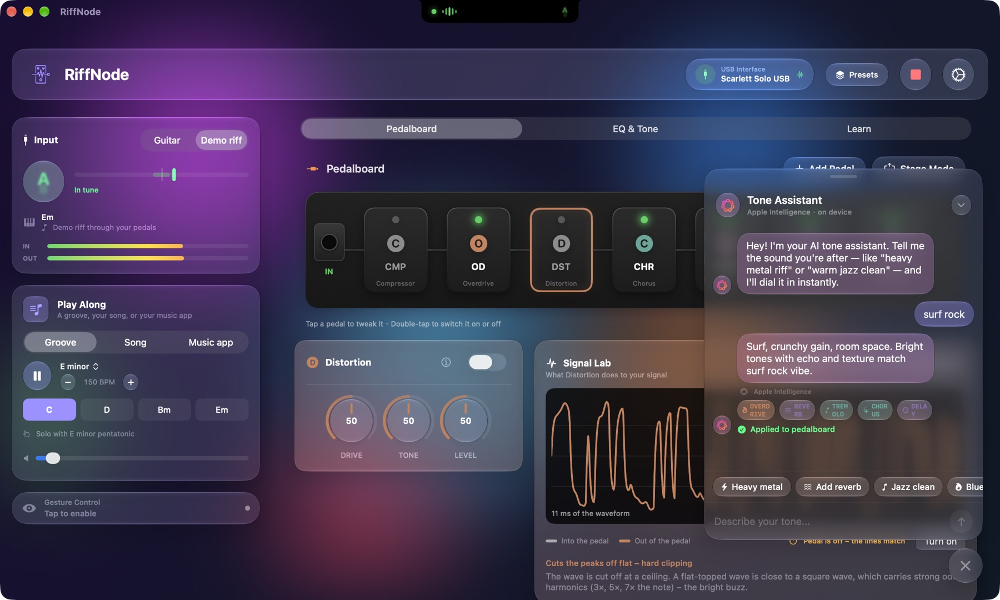
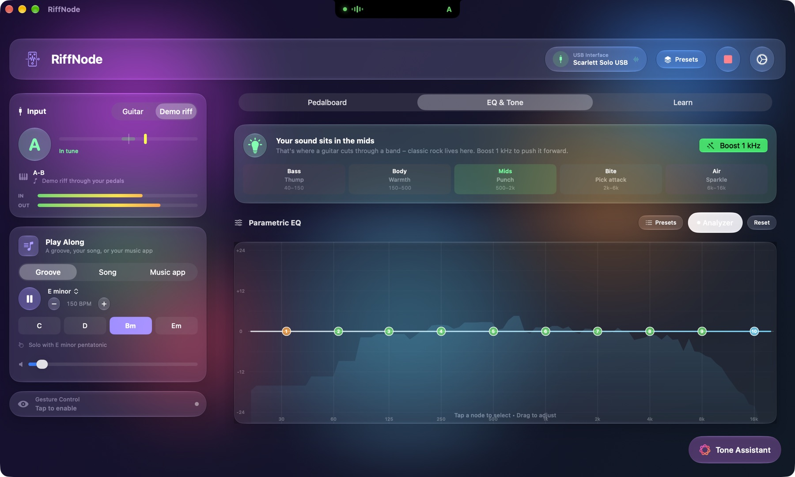
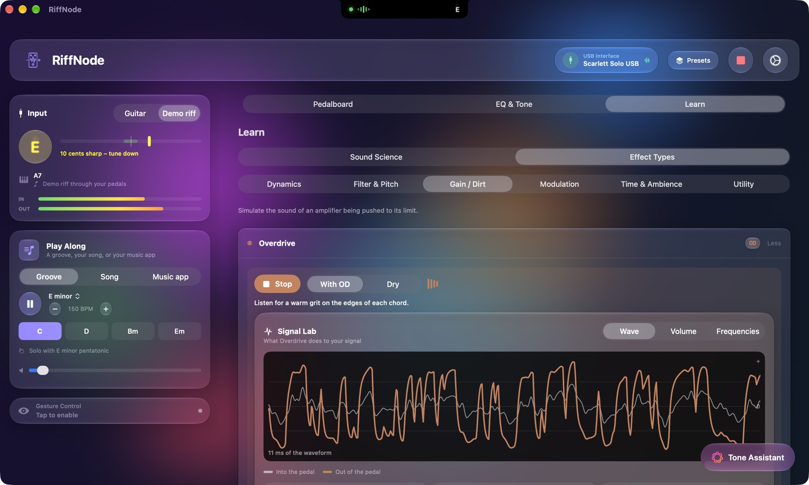
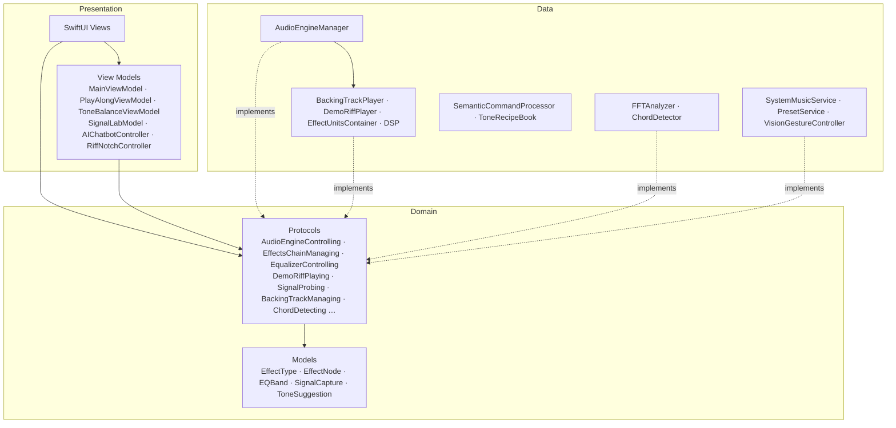
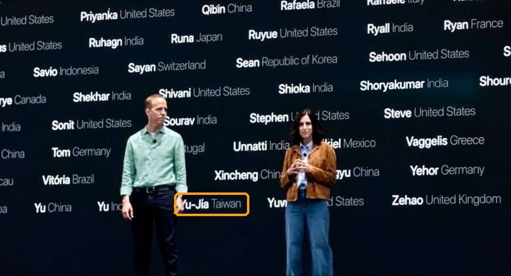
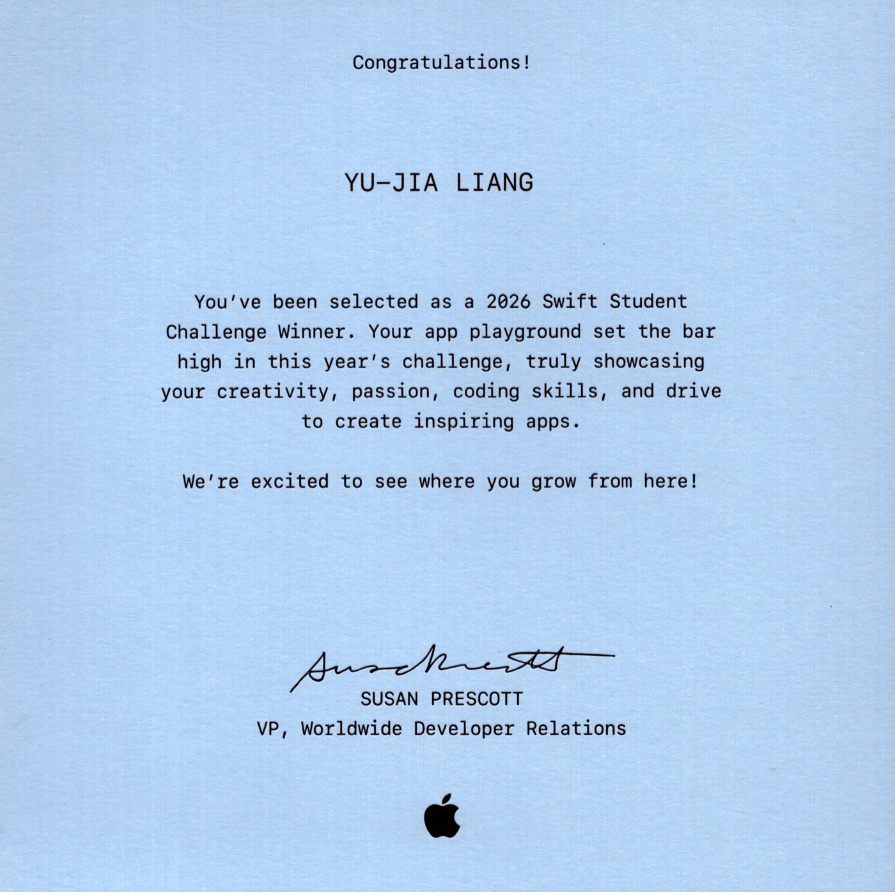
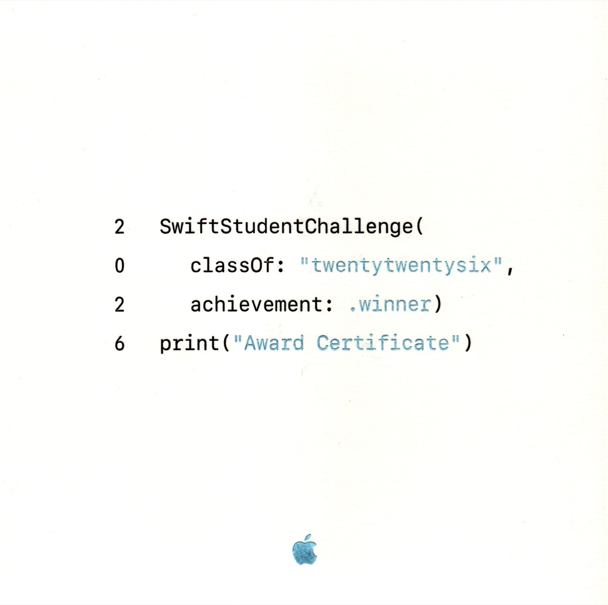
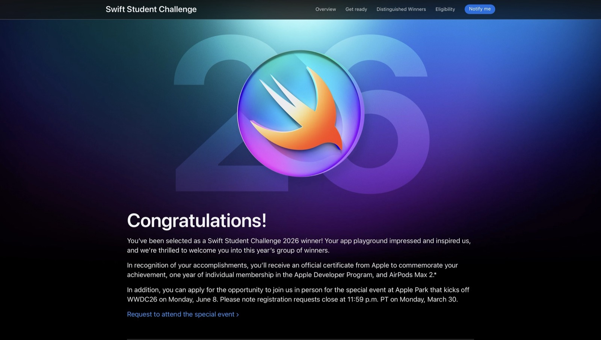

<p align="center">
  
</p>

<h1 align="center">RiffNode</h1>

<p align="center"><b>English</b> · <a href="README.zh-TW.md">繁體中文</a></p>

<p align="center">
  <strong>A visual guitar effects playground for iPad and Mac.</strong><br>
  Build a pedalboard, see your sound, and control it hands-free – all on device, all offline.
</p>

<p align="center">
  <a href="#try-it-in-3-minutes">Try it</a> ·
  <a href="#why-riffnode">Why RiffNode</a> ·
  <a href="#the-riff-notch">Riff Notch</a> ·
  <a href="#features">Features</a> ·
  <a href="#architecture">Architecture</a> ·
  <a href="#swift-student-challenge-2026">Swift Student Challenge</a>
</p>

<p align="center">
  <a href="#swift-student-challenge-2026"></a>
  
  
  
  
  <a href="LICENSE"></a>
</p>

<p align="center">
  
</p>

Guitar effects are usually explained with jargon and sold as expensive boxes. RiffNode turns them into something you can **see, touch and hear** in a few minutes: drag pedals into a signal chain, watch the waveform and spectrum change as you play, ask the on-device AI for a tone in plain English, and switch presets with a nod of your head while both hands stay on the guitar.

## Why RiffNode

- **No guitar? Still playable.** A built-in demo riff – an original J-rock arpeggio over the IV–V–iii–vi "royal road" progression – is synthesized on device and fed into the chain exactly where a guitar would enter, so anyone can hear what each pedal does.
- **Always something to jam with.** A built-in drums-and-bass groove (C · D · Bm · Em, 150 BPM, any minor key) is also synthesized on device – or import your own song, or play along with Apple Music and Spotify.
- **See the physics.** The Signal Lab draws each pedal's input against its output, live – distortion flattening the peaks, a compressor squeezing the volume, a flanger's comb of notches – with measurements that put numbers on the change.
- **Hands-free control.** Vision face tracking turns head nods and tilts into preset changes and bypass, and your mouth into a wah pedal – a resonant band-pass that sweeps from 350 Hz to 2.2 kHz as you open it.
- **Describe the tone, get the tone.** Foundation Models recognises "surf rock" or "Comfortably Numb solo" and RiffNode dials in the pedals, entirely on device – showing each step live as it thinks.
- **Learn by listening.** Every effect in the guide has a **Hear it** button: the demo riff plays through that pedal alone, with an A/B switch against the dry sound.
- **Private and offline.** No account, no network, no analytics. Audio, camera frames and AI prompts never leave the device.

## Try it in 3 minutes

| Step | What to do | What you'll see |
| --- | --- | --- |
| 1 | Tap **Get Started** and allow the microphone | The audio engine starts and the Riff Notch turns green |
| 2 | Tap **Take the Tour** (or skip it) | A short walkthrough of the signal chain |
| 3 | Tap **No guitar? Try the Demo Riff** (`⌘D`) | A riff plays through your pedals; the Signal Lab, tuner and chord detector come alive |
| 4 | Tap a pedal, or double-tap to bypass it | The sound and the spectrum change instantly; the notch announces the change |
| 5 | Open the **Tone Assistant** (`⌘J`) and tap *Ambient pad* | Watch it pick pedals and settings step by step, then rebuild the chain |
| 6 | Press play on **Groove** in Play Along | Drums and bass in any minor key; the current chord lights up |
| 7 | Turn on **Gesture Control** and nod | Presets switch hands-free, with feedback in the notch |

> [!TIP]
> Plug a guitar into any USB audio interface to play through the same chain live. The built-in microphone also works for quick tests.

## The Riff Notch

A Dynamic Island–style notch hangs from the top of the window on both iPad and Mac. It gives you feedback while your eyes are on the fretboard – especially important for head gestures, which otherwise have no visual response.

| State | Shows |
| --- | --- |
| **Closed** | Engine LED, live input level, the note you're playing (green when in tune) |
| **Popping** | A short banner when a preset, pedal, gesture or engine state changes |
| **Opened** | Tuner, IN/OUT meters, start/stop, previous/next preset and tap-to-toggle pedal chips |

Tap it or press `⌘K` to open it. Its shape, states and spring animation are inspired by [NotchDrop](https://github.com/Lakr233/NotchDrop), rebuilt as a single animatable SwiftUI `Shape` so it works inside an App Playground on iPad and Mac Catalyst.

## Features

### Real-time effects

11 effect types, built on `AVAudioEngine`. Every pedal stays wired in chain order, so switching one on or off is an instant bypass. Chorus, Flanger, Phaser and Tremolo, and the Overdrive (soft clip), Distortion (hard clip) and Fuzz waveshapers, run in a custom in-process **Audio Unit** with real DSP – every knob changes the signal.

| Category | Effects |
| --- | --- |
| Dynamics | Compressor |
| Filter & Pitch | Parametric EQ (10 bands, draggable curve, 14 presets) |
| Gain / Dirt | Overdrive · Distortion · Fuzz |
| Modulation | Chorus · Phaser · Flanger · Tremolo |
| Time & Ambience | Delay · Reverb |

**14 built-in presets** across Clean, Crunch, Heavy and Ambient – from *Slapback Echo* to *Djent Machine* and *Shoegaze*. **Stage Mode** turns the pedalboard into a full-screen performance view with large footswitches.

### Hands-free Vision control

| Gesture | Default action |
| --- | --- |
| Nod down / up | Next / previous preset |
| Tilt left / right | Bypass all / enable all |
| Open mouth | Wah – closed is heel down (dark), open is toe down (bright) |
| Raise eyebrows | Toggle compressor |

### On-device AI

- **Tone Assistant** – chat in plain English. Commands that name a pedal ("more reverb") run instantly and exactly on device; described sounds ("Comfortably Numb solo") go to Foundation Models, which sketches the sound with `@Generable` (style, gain, space, signature pedals) while a recipe book sets the knobs – the model recognises music well but picks poor raw numbers. Output is streamed, so the chat shows what the model is doing.
- **Signal Lab** – taps on both sides of the selected pedal show its waveform, volume envelope and spectrum before and after, plus peakiness, loudness range, brightness and gap measurements.
- **Play Along** – a built-in groove in any minor key and tempo with chord highlighting and the scale to solo with, your own songs, or Apple Music (controlled in-app on iPad) and Spotify playing alongside.
- **Honest fallback** – RiffNode checks `SystemLanguageModel.availability`. Without Apple Intelligence an offline tone matcher answers instead, and every reply is labelled with which one responded.
- **Chord → tone suggestions** – when a chord is held steadily, RiffNode suggests a matching tone you can apply in one tap.
- **Tuner & Tone balance** – a cents-accurate tuner and chord detection in the Input card; on the EQ tab, a tone-balance card that shows which range your sound sits in (bass, body, mids, bite, air), explains it in plain words and applies the matching EQ move in one tap. FFT (Accelerate / vDSP) and autocorrelation pitch detection power it all; the same live spectrum is drawn behind the Parametric EQ curve.

### Keyboard shortcuts (Mac and iPad)

| Shortcut | Action |
| --- | --- |
| `⌘↩` | Start / stop the engine |
| `⌘D` | Play / stop the demo riff |
| `⌘←` `⌘→` | Previous / next preset |
| `⌘K` | Open / close the Riff Notch |
| `⌘J` | Open / close the Tone Assistant |
| `⌘1` – `⌘3` | Pedalboard · EQ & Tone · Learn |

## Gallery

<table>
  <tr>
    <td width="50%"><br><sub><b>Tone Assistant</b> – “surf rock”, answered on device by Apple Intelligence</sub></td>
    <td width="50%"><br><sub><b>EQ &amp; Tone</b> – where your sound sits, and the EQ move to fix it in one tap</sub></td>
  </tr>
  <tr>
    <td colspan="2"><br><sub><b>Learn</b> – hear a pedal on its own and watch what it does to the wave</sub></td>
  </tr>
</table>

## Technical stack

| Component | Technology | How it's used |
| --- | --- | --- |
| Language | Swift 6 | Strict concurrency checking, `Sendable` audio data |
| UI | SwiftUI · Liquid Glass | `glassEffect`, `GlassEffectContainer`, `Canvas` visualizers at 30–60 fps |
| Audio | AVFoundation | `AVAudioEngine`, `AVAudioUnit` effects, input taps, player nodes |
| DSP | Accelerate (vDSP) | FFT spectrum, autocorrelation pitch detection |
| Vision | Vision | `VNDetectFaceLandmarksRequest` for head and face gestures |
| AI | Foundation Models | On-device `LanguageModelSession` with `@Generable` tone parameters |
| State | Observation | `@Observable` view models and services |

### Implementation notes

- **Swift 6 audio taps** – tap blocks are global, non-isolated functions writing into a lock-protected buffer, so no `@MainActor` closure ever runs on the audio thread.
- **Responsive start-up** – `AVAudioSession` activation runs off the main thread.
- **Demo riff and groove** – Karplus–Strong plucked strings (all-pass tuned, with filtered pick noise and ghost-note mutes), plus synthesized kick, snare, hi-hat and bass, render on device with seeded generators – no bundled audio files. Imported songs are converted to the engine's sample rate with `AVAudioConverter`.
- **Real-time modulation DSP** – a custom `AUAudioUnit` processes in place on the audio thread with no allocation or locks; parameters cross threads through `Synchronization.Atomic`.
- **Fast on-device AI** – the model fills a small `@Generable` sketch (style, gain, space, up to three signature pedals) instead of raw knob values; a prewarmed session per request answers in about 3.5 seconds on the macOS 27 model and never overflows the 4K context window.

## Architecture

RiffNode follows **MVVM** inside a **Clean Architecture** layout. Dependencies point inward: Presentation and Data both depend on Domain, never on each other's concrete types.



```
RiffNode.swiftpm/
├── App/                    Composition root: creates the engine, routes Welcome → Tour → Main
├── Domain/                 Pure Swift (Foundation only)
│   ├── Models/             Effects, presets, EQ, signal captures, input devices, learning content
│   └── Protocols/          One protocol per capability (engine, chain, EQ, demo riff, probe, play-along …)
├── Data/
│   ├── Audio/              AudioEngineManager (graph) · BackingTrackPlayer · DemoRiffPlayer
│   │                       EffectUnitsContainer · synthesizers · DSP/ (custom Audio Unit)
│   ├── Analysis/           FFTAnalyzer, ChordDetector, SignalProbe
│   ├── AI/                 SemanticCommandProcessor, ToneRecipeBook
│   ├── Playback/           SystemMusicService (Apple Music)
│   ├── Vision/ · Presets/ · Learning/
├── Presentation/
│   ├── ViewModels/         Feature view models + EngineRequirements (what each screen may use)
│   ├── Views/              One folder per feature: Main, Pedalboard, EQ, Learn, AI, Notch …
│   └── DesignSystem/       Tokens, glass components, NotchShape, DomainColors
└── Core/Extensions/
```

- **Interface segregation** – the engine is exposed as small capability protocols. Each screen declares what it needs in `EngineRequirements` (for example `SignalLabEngine = AudioEngineControlling & DemoRiffPlaying & SignalProbing & EffectsChainManaging`), so a view can't reach anything else.
- **Dependency inversion** – views and view models hold `any …` protocol types; only `ContentView`, the composition root, creates `AudioEngineManager`.
- **A UI-free Domain** – colours live in `Presentation/DesignSystem/DomainColors.swift` and AVFoundation mappings in `Data`, so `Domain` imports only Foundation.
- **Single responsibility** – play-along, the demo riff and the effect units are their own classes; feature rules (which mode stops what, tone-balance hysteresis) live in view models, not views.

## Getting started

### Requirements

- iPadOS 26 or macOS 26 (Apple silicon)
- Swift Playgrounds on iPad or Mac, or Xcode 26+
- Optional: a guitar and USB audio interface, and a front camera for gestures

### Run

```bash
git clone https://github.com/RiffNode/riffnode-wwdc2026.git
open riffnode-wwdc2026/RiffNode.swiftpm
```

Open `RiffNode.swiftpm` in Swift Playgrounds or Xcode and run it on iPad or **My Mac**. The demo riff works in the iPad simulator; live guitar input and gestures need a real device.

## Swift Student Challenge 2026

RiffNode was selected by Apple as a **2026 Swift Student Challenge Winner** – one of 350 winners worldwide and one of eight from Taiwan this year.

<p align="center">
  
  <br><sub>On stage at WWDC26 – <b>Yu-Jia, Taiwan</b> on the winners wall</sub>
</p>

<table>
  <tr>
    <td width="50%"><br><sub>The winner letter from Apple</sub></td>
    <td width="50%"><br><sub>The award card – <code>achievement: .winner</code></sub></td>
  </tr>
  <tr>
    <td colspan="2"><br><sub>The winner notice on Apple Developer</sub></td>
  </tr>
</table>

It was built as an App Playground for the challenge's format:

- Runs **fully offline** – no network calls, no downloaded models or assets.
- Delivers the core experience in **under three minutes**, with or without a guitar.
- Ships as a single `.swiftpm` with no third-party dependencies.

It brings low-level signal processing, computer vision and on-device AI together to make music technology something you can explore, not just read about. Development has continued since the challenge – the Signal Lab, Play Along and the hybrid Tone Assistant came after it.

### In the news

| Date | Outlet | Article |
|---|---|---|
| 2026-05-08 | 中央社 CNA | [海大梁祐嘉開發吉他效果器APP 獲蘋果WWDC學生挑戰賽獎](https://www.cna.com.tw/postwrite/chi/432895) |
| 2026-05-08 | 聯合報 United Daily News | [蘋果WWDC26學生挑戰賽 海大梁祐嘉吉他APP獲獎](https://udn.com/news/story/6928/9489917) |
| 2026-05-08 | yam 蕃薯藤 | [海大梁祐嘉開發吉他效果器APP 奪蘋果WWDC26學生大獎](https://n.yam.com/Article/20260508583843) |
| 2026-05-11 | 1111 人力銀行 | [海大生開發AI吉他效果器APP 獲蘋果 WWDC學生挑戰賽](https://www.1111.com.tw/news/165780/amp/) |
| 2026-04-20 | 數位時代 BusinessNext | [蘋果Swift Student Challenge揭曉，台灣8人得獎！](https://www.bnext.com.tw/article/90716/swift-student-challenge) |
| 2026-04-15 | NOWnews 今日新聞 | [蘋果WWDC學生賽8台生獲獎！](https://www.nownews.com/news/6807253) |
| 2026-04-14 | T客邦 TechBang | [蘋果 WWDC26 學生挑戰賽：台灣 8 位學生獲獎](https://www.techbang.com/posts/128826-apple-wwdc26-taiwan-students-ai-ar-winners) |
| 2026-04-14 | 聯合新聞網 udn Tech | [蘋果WWDC 2026 Swift學生挑戰賽：台灣8名學子入圍創紀錄](https://tech.udn.com/tech/story/123153/9439619) |
| 2026-04-13 | 科技新報 TechNews | [歷年來最多！2026 WWDC Swift Student Challenge 獲獎學生達 8 位](https://technews.tw/2026/04/13/2026-wwdc-swift-student-challenge-taiwan/) |

## Acknowledgements

- [NotchDrop](https://github.com/Lakr233/NotchDrop) by Lakr Aream (MIT) – inspiration for the notch shape, its states and its spring animation.
- Effect history and signal-chain guidance draw on common guitar-gear knowledge, written for this project.

## License

RiffNode is released under the [MIT License](LICENSE).

<p align="center">
  Made with ❤️ and a lot of feedback loops by Jesse
</p>
