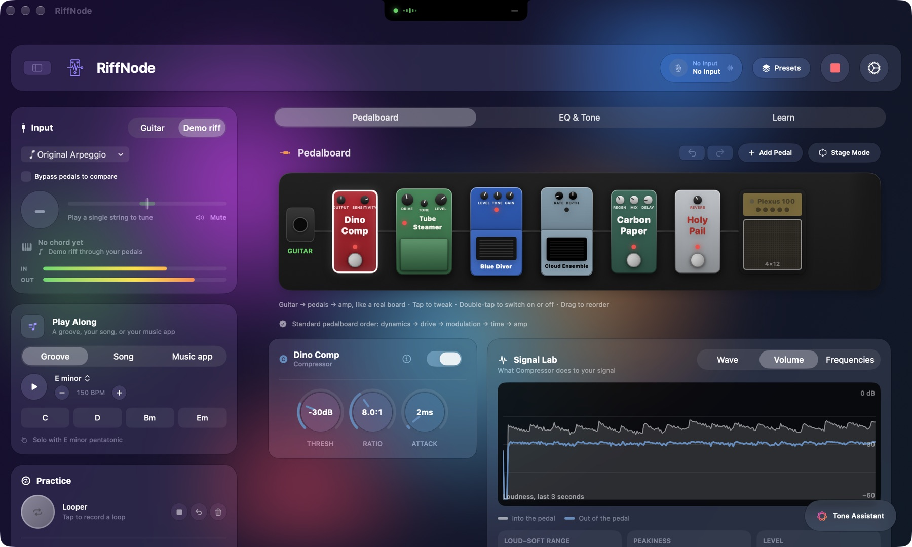
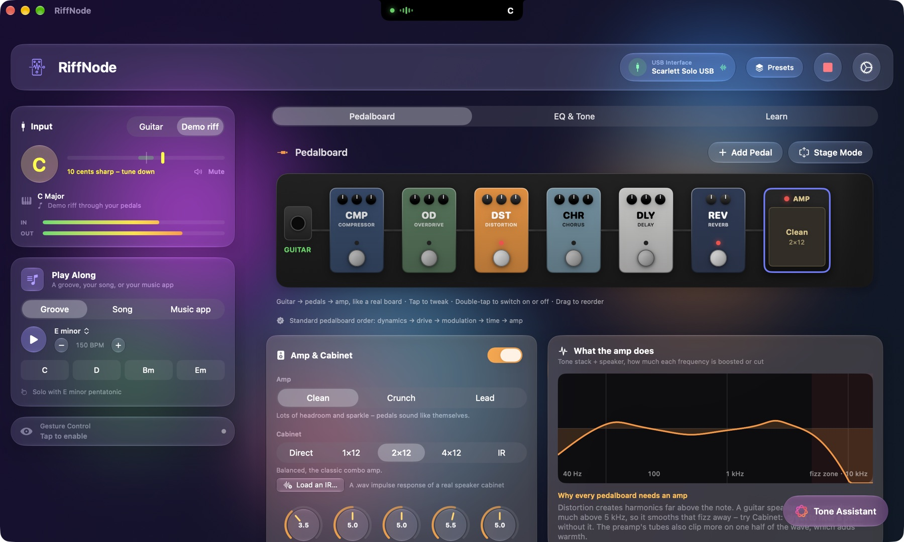
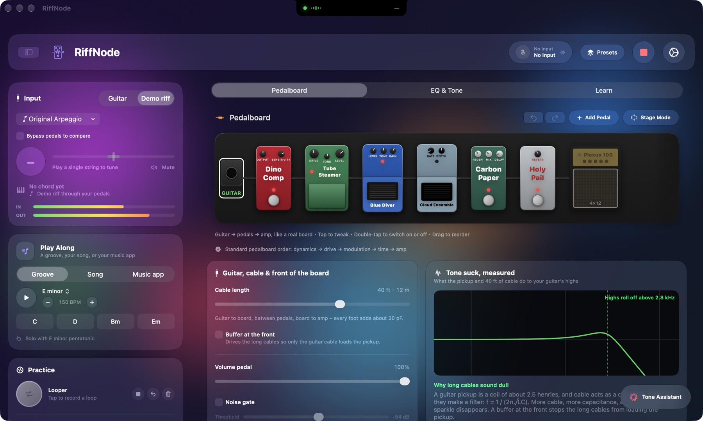
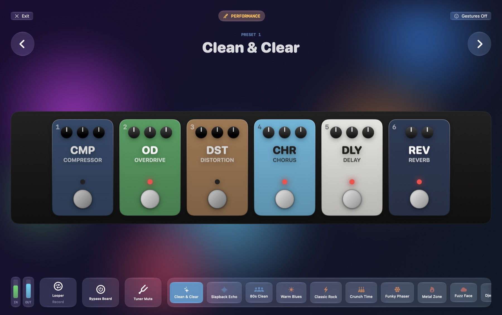
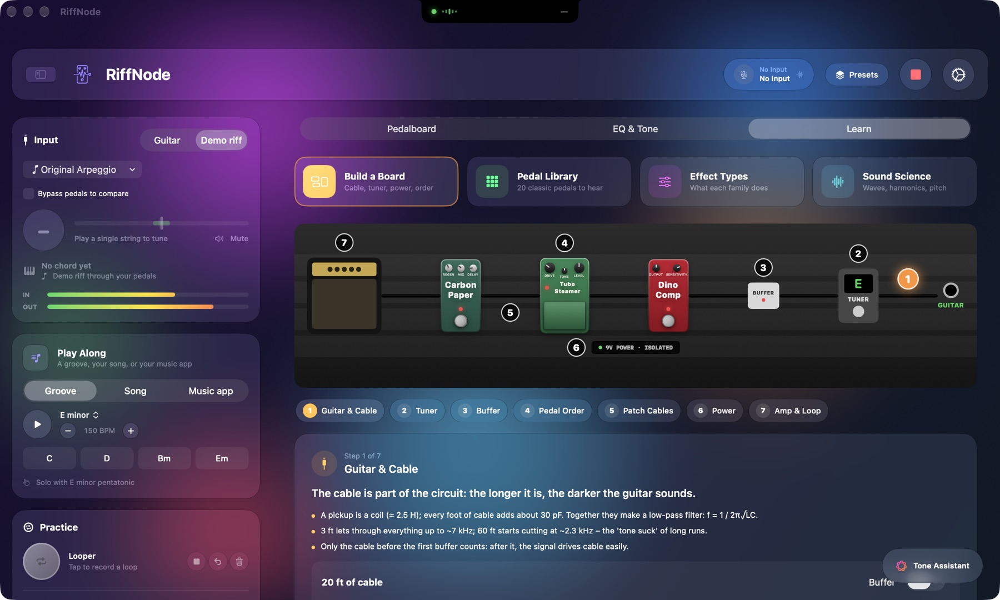
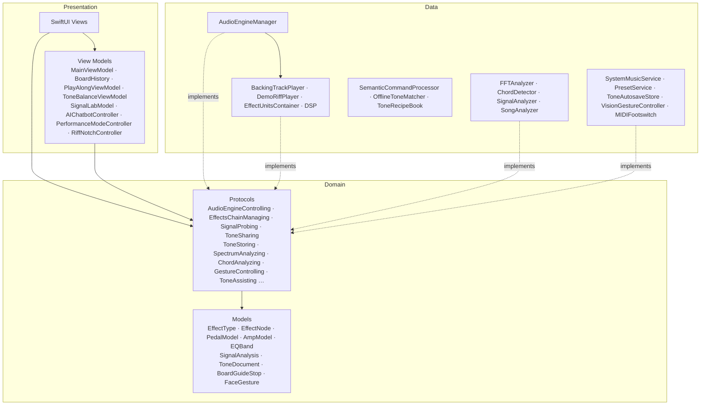
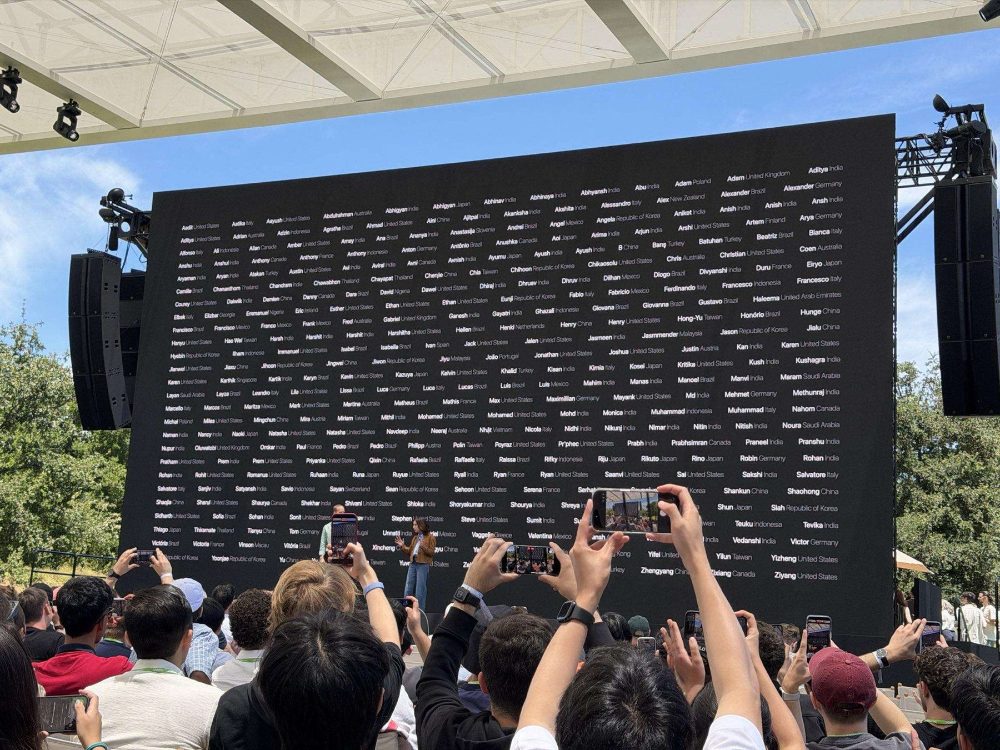
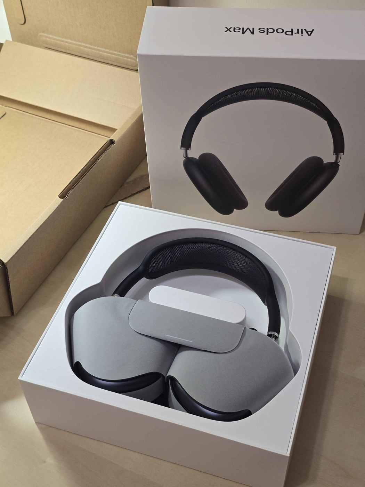

<p align="center">
  
</p>

<h1 align="center">RiffNode</h1>

<p align="center"><b>English</b> · <a href="README.zh-TW.md">繁體中文</a></p>

<p align="center">
  <strong>A visual guitar effects playground for iPad and Mac.</strong><br>
  Build a pedalboard, see your sound, and control it hands-free – all on device, all offline.
</p>

<p align="center">
  <a href="#try-it-in-3-minutes">Try it</a> ·
  <a href="#why-riffnode">Why RiffNode</a> ·
  <a href="#the-riff-notch">Riff Notch</a> ·
  <a href="#features">Features</a> ·
  <a href="#architecture">Architecture</a> ·
  <a href="#swift-student-challenge-2026">Swift Student Challenge</a>
</p>

<p align="center">
  <a href="#swift-student-challenge-2026"></a>
  
  
  
  
  <a href="LICENSE"></a>
</p>

<p align="center">
  
</p>

Guitar effects are usually explained with jargon and sold as expensive boxes. RiffNode turns them into something you can **see, touch and hear** in a few minutes: drag pedals into a signal chain, watch the waveform and spectrum change as you play, ask the on-device AI for a tone in plain English, and switch presets with a nod of your head while both hands stay on the guitar.

## Why RiffNode

- **No guitar? Still playable.** Play the original synthesized J-rock arpeggio, or import clean recordings of your own playing (several at once) and switch between them from the Input card. Both enter before the pedals. No microphone permission is needed for Demo; the pedalboard starts bypassed per pedal, and a comparison switch bypasses the whole board without changing its settings.
- **Always something to jam with.** A built-in drums-and-bass groove (C · D · Bm · Em, 150 BPM, any minor key) is also synthesized on device – or import your own song, or play along with Apple Music and Spotify.
- **A free pedalboard that behaves like a real one.** Painted stompboxes run from the guitar jack to an amp and speaker cabinet, in the order real players use – and RiffNode explains what an unusual order does to the sound. Even the cable is modelled: longer cable, duller highs.
- **See the physics.** The Signal Lab draws each pedal's input against its output, live – distortion flattening the peaks, a compressor squeezing the volume, a flanger's comb of notches – with measurements that put numbers on the change.
- **Hands-free control.** Vision face tracking turns head nods and tilts into preset changes and bypass, and your mouth into a wah pedal – a resonant band-pass that sweeps from 350 Hz to 2.2 kHz as you open it.
- **Describe the tone, get the tone.** Foundation Models recognises "surf rock" or "Comfortably Numb solo" and RiffNode dials in the pedals, entirely on device – showing each step live as it thinks.
- **Learn by listening.** Every effect in the guide has a **Hear it** button: the demo riff plays through that pedal alone, with an A/B switch against the dry sound.
- **Private and offline.** No account, no network, no analytics. Audio, camera frames and AI prompts never leave the device.

## Try it in 3 minutes

| Step | What to do | What you'll see |
| --- | --- | --- |
| 1 | Tap **Try the Demo Riff**, or **Connect a Guitar** for live input | The engine starts; only live input requests microphone access |
| 2 | Tap **Take the Tour** (or skip it) | A short walkthrough of the signal chain |
| 3 | Choose Demo in the Input card – the original arpeggio or **Import Recordings…** of your own (`⌘D` starts/stops Demo) | Enable a pedal, then use **Bypass pedals to compare** on the same performance |
| 4 | Tap a pedal, or double-tap to bypass it | The sound and the spectrum change instantly; the notch announces the change |
| 5 | Open the **Tone Assistant** (`⌘J`) and tap *Ambient pad* | Watch it pick pedals and settings step by step, then rebuild the chain |
| 6 | Press play on **Groove** in Play Along | Drums and bass in any minor key; the current chord lights up |
| 7 | Turn on **Gesture Control** and nod | Presets switch hands-free, with feedback in the notch |

> [!TIP]
> Plug a guitar into any USB audio interface to play through the same chain live. The built-in microphone also works for quick tests.

## The Riff Notch

A Dynamic Island–style notch hangs from the top of the window on both iPad and Mac. It gives you feedback while your eyes are on the fretboard – especially important for head gestures, which otherwise have no visual response.

| State | Shows |
| --- | --- |
| **Closed** | Engine LED, live input level, the note you're playing (green when in tune) |
| **Popping** | A short banner when a preset, pedal, gesture or engine state changes |
| **Opened** | Tuner, IN/OUT meters, start/stop, previous/next preset and tap-to-toggle pedal chips |

Tap it or press `⌘K` to open it. Its shape, states and spring animation are inspired by [NotchDrop](https://github.com/Lakr233/NotchDrop), rebuilt as a single animatable SwiftUI `Shape` so it works inside an App Playground on iPad and Mac Catalyst.

## Features

### Real-time effects

11 effect types, built on `AVAudioEngine`. Every pedal stays wired in chain order, so switching one on or off is an instant bypass. Chorus, Flanger, Phaser, Tremolo, the analog-style Delay, and the Overdrive (soft clip), Distortion (hard clip) and Fuzz waveshapers run in a custom in-process **Audio Unit** with real DSP – every knob changes the signal.

The board is laid out like a real one: **guitar → input stage → pedals → amp → cabinet**.

| Stage | What it models |
| --- | --- |
| Guitar & cable | The pickup (≈2.5 H) and cable (≈30 pF per foot) form a resonant low-pass, f = 1/(2π√LC): 3 ft rolls off above 7.3 kHz, 60 ft above 2.3 kHz. A front-of-board buffer saves the highs. Plus a volume pedal and a noise gate |
| Pedals | Drag to reorder; RiffNode flags unusual orders (time effects before drive, fuzz not first…), explains the sound, and restores the standard order in one tap |
| Amp | Five classic amps plus a modern lead and Neural Amp Modeler: asymmetric tube-style preamp, a bass / mid / treble tone stack placed before or after the preamp like the original circuit, power-amp saturation |
| Cabinet | 1×12, 2×12 or 4×12 speaker models – the roll-off above ~5 kHz that turns fizzy distortion into a guitar tone – or load your own **impulse response** (.wav), convolved in real time |

| Category | Effects |
| --- | --- |
| Dynamics | Compressor |
| Filter & Pitch | Parametric EQ (10 bands, draggable curve, 14 presets) |
| Gain / Dirt | Overdrive · Distortion · Fuzz |
| Modulation | Chorus · Phaser · Flanger · Tremolo |
| Time & Ambience | Delay · Reverb |

**14 built-in presets** across Clean, Crunch, Heavy and Ambient – from *Slapback Echo* to *Djent Machine* and *Shoegaze*. **Stage Mode** is the board for playing live, laid out like a real one: aluminium rails, the guitar plugging in on the right and the amp on the left, a tuner first that mutes while you tune, patch cables with right-angle plugs, 9 V leads coming up from the power brick under the rails – and every pedal on screen at once, one tap to stomp it. The preset name reads from across the room, with the looper, a board-wide bypass and tuner mute along the bottom – driven by touch, the keyboard, a MIDI foot controller or your head. The screen never dims while it is up.

### Classic pedals and amps

Twenty classic stompboxes and five classic amps, voiced after how their circuits work – a Tube Screamer-style mid hump, a Blues Driver's open, uneven clipping, a Big Muff's scooped wall of fuzz. Tap a pedal's name to swap it for another classic of its kind; any drive slot takes any drive, so you can stack two overdrives like on a real board.

| RiffNode pedal | Voiced after | What the circuit does |
| --- | --- | --- |
| Tube Steamer | Ibanez TS808 Tube Screamer | Soft clipping above ~720 Hz, clean bass blended back: the mid-hump push |
| Blue Diver | Boss BD-2 Blues Driver | Uneven discrete clipping, low bass cut: open, amp-like breakup |
| Copper Pegasus | Klon Centaur | Clean and germanium-clipped paths mixed: a transparent boost that grows hair |
| Compulsive Drive | Fulltone OCD | MOSFET soft knee that keeps the pick attack |
| Sunny Drive | Boss SD-1 | Asymmetric diodes: a brighter Tube Screamer cousin |
| The Mouse | ProCo RAT | ~60 dB of op-amp gain, hard clipping, a backwards filter |
| Dirt Station | Boss DS-1 | Hard clipping and a mid-scooping tone control |
| Plus Sign | MXR Distortion+ | Germanium diodes, no tone knob |
| Heavy Mettle | Boss HM-2 | Two gain stages and a scooped EQ: the "chainsaw" |
| Fuzz Grin | Arbiter Fuzz Face | Two transistors, asymmetric clipping, cleans up with the guitar's volume |
| Big Fluff | Electro-Harmonix Big Muff Pi | Two clipping stages and a mid-scoop tone |
| Dino Comp | MXR Dyna Comp | Fast-attack squash for country chicken-pickin' |
| Cloud Ensemble | Boss CE-2 | Bucket-brigade chorus |
| Orange Ninety | MXR Phase 90 | Four all-pass stages, one speed knob |
| Uni-Wave | Shin-ei Uni-Vibe | Mismatched stages and a throbbing lamp-like sweep |
| Electric Mystery | Electro-Harmonix Electric Mistress | Slow, short-delay flanging |
| Tremor Two | Boss TR-2 | Volume LFO from sine to choppy square |
| Carbon Paper | MXR Carbon Copy | Analog delay: each repeat darker and warmer |
| Digital Dee | Boss DD-3 | Clean, steady digital repeats |
| Holy Pail | Electro-Harmonix Holy Grail | One-knob reverb |

| RiffNode amp | Voiced after | Character |
| --- | --- | --- |
| Twain '65 | Fender Twin Reverb (blackface) | Tone stack before the tubes, scooped mids, bright cap, huge headroom |
| Tweedle '59 | Fender Bassman 5F6-A (tweed) | Mid-forward, early breakup |
| Top Boost 30 | Vox AC30 Top Boost | Chimey class-A upper mids |
| Plexus 100 | Marshall 1959 Super Lead (plexi) | Tone stack after the preamp: mids push through the crunch |
| Brit 800 | Marshall JCM800 2203 | Cascaded preamp: tight 80s rock |

Pedal and amp names, panels and enclosures are RiffNode's own – no logos or copied graphics. The originals are named only to describe the sound; all trademarks belong to their owners, and RiffNode is not affiliated with or endorsed by them.

### Hands-free Vision control

| Gesture | Default action |
| --- | --- |
| Nod down / up | Next / previous preset |
| Tilt left / right | Bypass all / enable all |
| Open mouth | Wah – closed is heel down (dark), open is toe down (bright) |
| Raise eyebrows | Toggle compressor (in Stage Mode: a momentary boost) |

### On-device AI

- **Tone Assistant** – chat in plain English. Commands that name a pedal ("more reverb") run instantly and exactly on device; described sounds ("Comfortably Numb solo") go to Foundation Models, which sketches the sound with `@Generable` (style, gain, space, signature pedals) while a recipe book sets the knobs – the model recognises music well but picks poor raw numbers. Output is streamed, so the chat shows what the model is doing.
- **Learn** – four chapters picked from big cards. *Build a Board* walks round a real pedalboard – guitar cable, tuner, buffer, pedal order, patch cables, power, amp – with a cable-length slider that moves the pickup's cutoff, a current budget for your own pedals and a daisy-chain ground loop you can see. The *Pedal Library* shows the twenty classics as real-looking pedals to hear (A/B against dry) and drop onto your board; *Effect Types* and *Sound Science* explain the families and the physics.
- **Signal Lab** – taps on both sides of the selected pedal show its waveform, volume envelope and spectrum before and after, plus peakiness, loudness range, brightness and gap measurements.
- **Play Along** – a built-in groove in any minor key and tempo with chord highlighting and the scale to solo with, your own songs, or Apple Music (controlled in-app on iPad) and Spotify playing alongside.
- **Honest fallback** – RiffNode checks `SystemLanguageModel.availability`. Without Apple Intelligence an offline tone matcher answers instead, and every reply is labelled with which one responded.
- **Chord → tone suggestions** – when a chord is held steadily, RiffNode suggests a matching tone you can apply in one tap.
- **Tuner & Tone balance** – a cents-accurate tuner and chord detection in the Input card; on the EQ tab, a tone-balance card that shows which range your sound sits in (bass, body, mids, bite, air), explains it in plain words and applies the matching EQ move in one tap. FFT (Accelerate / vDSP) and autocorrelation pitch detection power it all; the same live spectrum is drawn behind the Parametric EQ curve.

### Practice, sharing and live control

- **Low latency** – a ~5 ms I/O buffer, the measured string-to-ear latency in Settings, and a warning when Bluetooth headphones would add 100–200 ms.
- **Undo and autosave** – every change to the board (pedals, order, models, knobs, amp, EQ, and the cable, buffer and noise gate in front of it) is one undo step once it settles, so a knob drag is one step; the board is saved and comes back next launch.
- **Two of a kind** – stack two overdrives, or a short and a long delay: every pedal after the first of its type gets its own audio unit, and the Signal Lab probes exactly the one you picked.
- **Looper** – one footswitch: record, play, overdub, undo. It records the amp's output, so only your guitar is layered.
- **Metronome** – an accented click that can match the groove's tempo.
- **Neural Amp Modeler** – load a `.nam` capture of a real amp. A Swift port of NeuralAmpModelerCore's WaveNet on Accelerate, for both the original A1 captures and the newer A2 ones (slimmable containers – the full-size model is used – with per-layer kernel sizes, LeakyReLU and a temporal head). Verified sample by sample against the reference renderer: 132–135 dB SNR, 13–22× real time. Open the amp at the end of the board and choose **Load a NAM capture…**; experimental options (FiLM conditioning, in-layer slimming) are refused with a clear message rather than played wrong.
- **Share a tone** – export pedals, amp and EQ as a small JSON file, or import one.
- **MIDI footswitch** – USB or Bluetooth MIDI pedals: Program Change selects a preset; CC 80/81 next/previous, CC 82 looper, CC 83 mute.
- **iOS / macOS 27** – imported songs are analysed on device with the Music Understanding framework (key, tempo, sections, solo scale), and the Tone Assistant can suggest a sound from a photo through Foundation Models image prompts.

### Accessibility

- Text follows the system text size (Dynamic Type); pedal and amp artwork keeps the fixed sizes of the hardware it draws, and fixed-size controls grow up to extra large.
- Reduce Motion stills the animated background and indicators; Reduce Transparency removes the colour orbs behind the glass; Increase Contrast gives glass cards a clear edge.
- Knobs are adjustable with VoiceOver (swipe up/down); pedals, the tuner and Stage Mode's footswitches have spoken labels and values.
- **Plots you can hear** – the EQ curve, the pickup-and-cable response and Signal Lab's before/after plots describe themselves as charts (`AXChartDescriptor`). VoiceOver reads the axes and a summary ("boost 3 dB at 1.0 kHz"), steps through the values, and plays the curve as a rising and falling tone with Audio Graph.
- Each EQ band is one VoiceOver element: swipe up or down for gain, and use the Raise / Lower frequency actions to move it a third of an octave.

### Keyboard shortcuts (Mac and iPad)

| Shortcut | Action |
| --- | --- |
| `⌘↩` | Start / stop the engine |
| `⌘D` | Play / stop the demo riff |
| `⌘←` `⌘→` | Previous / next preset |
| `⌘K` | Open / close the Riff Notch |
| `⌘J` | Open / close the Tone Assistant |
| `⌘1` – `⌘3` | Pedalboard · EQ & Tone · Learn |
| `⌘Z` · `⇧⌘Z` | Undo · redo any change to the board |
| `⌃⌘S` | Show or hide the sidebar |
| `1` – `9` | Stage Mode: stomp pedal 1–9 |
| `←` `→` · `L` · `B` · `T` · `Esc` | Stage Mode: presets · looper · bypass board · tuner mute · exit |

## Gallery

<table>
  <tr>
    <td width="50%"><br><sub><b>Tone Assistant</b> – “surf rock”, answered on device by Apple Intelligence</sub></td>
    <td width="50%"><br><sub><b>EQ &amp; Tone</b> – where your sound sits, and the EQ move to fix it in one tap</sub></td>
  </tr>
  <tr>
    <td><br><sub><b>Amp &amp; Cabinet</b> – the speaker that takes the fizz out of distortion</sub></td>
    <td><br><sub><b>Guitar &amp; cable</b> – tone suck, measured: f = 1/(2π√LC)</sub></td>
  </tr>
  <tr>
    <td><br><sub><b>Pedal Library</b> – twenty classics: see the circuit, hear it, put it on your board</sub></td>
    <td><br><sub><b>Stage Mode</b> – a real board: tuner first, patch cables, power, one tap to stomp</sub></td>
  </tr>
  <tr>
    <td colspan="2"><br><sub><b>Build a Board</b> – a real pedalboard, one numbered part at a time</sub></td>
  </tr>
</table>

## Technical stack

| Component | Technology | How it's used |
| --- | --- | --- |
| Language | Swift 6 | Strict concurrency checking, `Sendable` audio data |
| UI | SwiftUI · Liquid Glass | `glassEffect`, `GlassEffectContainer`, `Canvas` visualizers at 30–60 fps |
| Audio | AVFoundation | `AVAudioEngine`, `AVAudioUnit` effects, input taps, player nodes |
| DSP | Accelerate (vDSP) | FFT spectrum, autocorrelation pitch detection |
| Vision | Vision | `VNDetectFaceLandmarksRequest` for head and face gestures |
| AI | Foundation Models | On-device `LanguageModelSession` with `@Generable` tone parameters |
| State | Observation | `@Observable` view models and services |

### Implementation notes

- **Swift 6 audio taps** – tap blocks are global, non-isolated functions writing into a lock-protected buffer, so no `@MainActor` closure ever runs on the audio thread.
- **Responsive start-up** – `AVAudioSession` activation runs off the main thread.
- **Demo riff and groove** – Karplus–Strong plucked strings (all-pass tuned, with filtered pick noise and ghost-note mutes), plus synthesized kick, snare, hi-hat and bass, render on device with seeded generators. No audio files are bundled; clean recordings you import for Demo, and songs for Play Along, are converted to the engine's sample rate with `AVAudioConverter`.
- **Real-time DSP** – a custom `AUAudioUnit` processes in place on the audio thread with no allocation or locks; knob values cross threads through `Synchronization.Atomic`. The amp's filter coefficients and cabinet IRs are prepared on the main thread in one of two banks; the audio thread announces which bank it is reading and re-checks it is still current, so the main thread never rewrites a bank mid-read – even when settings change twice within one audio block. A stress test swaps banks 200 000 times against a concurrent reader and checks no copy is ever torn.
- **Low latency** – a ~5 ms I/O buffer (256 frames at 48 kHz); Settings shows the measured round trip (input + output latency + two buffers) and warns when Bluetooth output adds 100–200 ms. Pedals stay wired and switch with `shouldBypassEffect`, so toggling never rebuilds the graph.
- **A free main thread** – pitch and chord detection run off the main actor (vectorised with `vDSP_dotpr`); each result carries a generation number, so a result that finishes after a reset or a source switch is dropped instead of overwriting newer state. FFT buffers are allocated once, not per frame.
- **Measured headroom** – `scripts/bench-audio.sh` renders a board of 11 DSP stages (input stage, wah, three drives, four modulations, analog delay, amp) in 128-frame buffers. On an M1 Pro it runs about 59× real time (1.7% of one core); a standard A1 NAM capture adds about 5% (20× real time). Even the 99.9th-percentile buffer takes under 0.5 ms of its 2.67 ms budget.
- **Clean clipping** – the overdrive, distortion and fuzz clippers run 4× oversampled, so harmonics above Nyquist don't fold back as harsh aliasing.
- **Cabinet IRs** – loaded files are resampled with `AVAudioConverter`, trimmed to 2048 taps, peak-normalised and convolved with `vDSP_conv`.
- **Fast on-device AI** – the model fills a small `@Generable` sketch (style, gain, space, up to three signature pedals) instead of raw knob values; a prewarmed session per request answers in about 3.5 seconds on the macOS 27 model and never overflows the 4K context window.

## Architecture

RiffNode follows **MVVM** inside a **Clean Architecture** layout. Dependencies point inward: Presentation and Data both depend on Domain, never on each other's concrete types.



```
RiffNode.swiftpm/
├── App/                    AppDependencies (protocols only) and its live() factory – the composition
│                           root, the only place that names concrete Data types – and ContentView
├── Domain/                 Pure Swift (Foundation only)
│   ├── Models/             Effects, classic pedals & amps, presets, EQ, signal analysis, tone files,
│   │                       the board guide, gestures – plus small pure rules (pedal order, use a model)
│   └── Protocols/          One protocol per capability: audio (engine, chain, EQ, probe, sharing …),
│                           interaction (analysis, gestures, Tone Assistant) and learning
├── Data/
│   ├── Audio/              AudioEngineManager (graph) split by concern (+AmpAndInput, +ChainSync,
│   │                       +PedalUnits, +SignalProbe …) · players · EffectUnitsContainer · DSP/
│   ├── Analysis/           FFTAnalyzer, ChordDetector, SignalProbe, SignalAnalyzer, SongAnalyzer
│   ├── AI/                 SemanticCommandProcessor, OfflineToneMatcher, ToneRecipeBook, ToneModels
│   ├── Playback/ · MIDI/ · Vision/ · Presets/ (incl. autosave) · Learning/ · Logging
├── Presentation/
│   ├── ViewModels/         Feature view models + EngineRequirements (what each screen may use)
│   ├── Views/              One folder per feature: Main, Pedalboard, Performance, EQ, Learn, AI …
│   └── DesignSystem/       Tokens, glass card, buttons, knob, tab bar, background, layout, DomainColors
└── Core/Extensions/
```

- **Interface segregation** – the engine is exposed as small capability protocols. Each screen declares what it needs in `EngineRequirements` (for example `SignalLabEngine = AudioEngineControlling & DemoRiffPlaying & SignalProbing & EffectsChainManaging`), so a view can't reach anything else.
- **Dependency inversion** – views and view models hold `any …` protocol types. `AppDependencies` holds only protocols; its `live()` factory, in a file of its own, is the one place that names concrete Data types (previews borrow it too). So `MainViewModel` runs against fakes in the tests, with no audio engine, camera or MIDI, and `BoardHistory` sees the board only as `ToneSharing` and its store as `ToneStoring`.
- **A UI-free Domain** – colours live in `Presentation/DesignSystem/DomainColors.swift` and AVFoundation mappings in `Data`, so `Domain` imports only Foundation.
- **Single responsibility** – play-along, the demo riff, the effect units, signal analysis and the offline tone matcher are their own types; feature rules (which mode stops what, tone-balance hysteresis, undo) live in view models, and board rules (placing a classic pedal, pedal-order advice) in the Domain – views only render and forward intents.
- **Open/closed** – a new classic pedal or amp is data (a `PedalModel` / `AmpVoice` entry with its voicing and look); the DSP and the drawing code don't change.

## Getting started

### Requirements

- iPadOS 26 or macOS 26 (Apple silicon)
- Swift Playgrounds on iPad or Mac, or Xcode 26+
- Optional: a guitar and USB audio interface, and a front camera for gestures

### Run

```bash
git clone https://github.com/RiffNode/riffnode-wwdc2026.git
open riffnode-wwdc2026/RiffNode.swiftpm
```

Open `RiffNode.swiftpm` in Swift Playgrounds or Xcode and run it on iPad or **My Mac**. The demo riff works in the iPad simulator; live guitar input and gestures need a real device.

## Swift Student Challenge 2026

RiffNode was selected by Apple as a **2026 Swift Student Challenge Winner** – one of 350 winners worldwide and one of eight from Taiwan this year.

<p align="center">
  
  <br><sub>On stage at WWDC26 – <b>Yu-Jia, Taiwan</b> on the winners wall</sub>
</p>

<p align="center">
  
  <br><sub>Apple Park, Cupertino, California · WWDC26, June 8, 2026 – the full wall of this year's winners</sub>
</p>

<table>
  <tr>
    <td width="50%"><br><sub>The winner letter from Apple</sub></td>
    <td width="50%"><br><sub>The award card – <code>achievement: .winner</code></sub></td>
  </tr>
  <tr>
    <td colspan="2"><br><sub>The winner notice on Apple Developer</sub></td>
  </tr>
</table>

### The prize



Every 2026 winner received:

- A **personalised certificate** from Apple
- **One year** of individual membership in the **Apple Developer Program**
- **AirPods Max 2**
- An invitation to apply for the **special event at Apple Park** that kicked off WWDC26 on June 8

<br clear="right">

### The rules, and how RiffNode meets them

| Rule | RiffNode |
| --- | --- |
| An individual **App Playground** (`.swiftpm`) in a ZIP of **25 MB or less** | The original submission used one `.swiftpm` with synthesized audio and no bundled models; the current version still bundles no audio – Demo recordings are imported by the player |
| Runs **fully offline** (network access is disabled during judging) | No network calls; Apple Intelligence runs on device, with an offline fallback |
| An experience of **three minutes or less** | Demo riff, Signal Lab and Tone Assistant all reachable from the first screen |
| Built with **Swift Playgrounds 4.6+ or Xcode 26+** | Swift 6, SwiftUI, iPadOS / macOS 26 |
| App text and written responses in **English** | All in-app text is English |

It brings low-level signal processing, computer vision and on-device AI together to make music technology something you can explore, not just read about. Development has continued since the challenge – the Signal Lab, Play Along and the hybrid Tone Assistant came after it.

### In the news

| Date | Outlet | Article |
|---|---|---|
| 2026-05-08 | 中央社 CNA | [海大梁祐嘉開發吉他效果器APP 獲蘋果WWDC學生挑戰賽獎](https://www.cna.com.tw/postwrite/chi/432895) |
| 2026-05-08 | 聯合報 United Daily News | [蘋果WWDC26學生挑戰賽 海大梁祐嘉吉他APP獲獎](https://udn.com/news/story/6928/9489917) |
| 2026-05-08 | yam 蕃薯藤 | [海大梁祐嘉開發吉他效果器APP 奪蘋果WWDC26學生大獎](https://n.yam.com/Article/20260508583843) |
| 2026-05-11 | 1111 人力銀行 | [海大生開發AI吉他效果器APP 獲蘋果 WWDC學生挑戰賽](https://www.1111.com.tw/news/165780/amp/) |
| 2026-04-20 | 數位時代 BusinessNext | [蘋果Swift Student Challenge揭曉，台灣8人得獎！](https://www.bnext.com.tw/article/90716/swift-student-challenge) |
| 2026-04-15 | NOWnews 今日新聞 | [蘋果WWDC學生賽8台生獲獎！](https://www.nownews.com/news/6807253) |
| 2026-04-14 | T客邦 TechBang | [蘋果 WWDC26 學生挑戰賽：台灣 8 位學生獲獎](https://www.techbang.com/posts/128826-apple-wwdc26-taiwan-students-ai-ar-winners) |
| 2026-04-14 | 聯合新聞網 udn Tech | [蘋果WWDC 2026 Swift學生挑戰賽：台灣8名學子入圍創紀錄](https://tech.udn.com/tech/story/123153/9439619) |
| 2026-04-13 | 科技新報 TechNews | [歷年來最多！2026 WWDC Swift Student Challenge 獲獎學生達 8 位](https://technews.tw/2026/04/13/2026-wwdc-swift-student-challenge-taiwan/) |

## Roadmap

- Full recovery from audio route changes and interruptions (unplugging an interface, phone calls)
- A lock-free ring buffer between the analysis taps and the UI
- Hand-gesture (Vision) camera lifecycle across scenes
- Saving the input stage (cable, buffer, gate) with the rest of the board
- An EQ curve drawn from the exact filter response
- Streaming long backing tracks, synced with the metronome and looper

## Acknowledgements

- [NotchDrop](https://github.com/Lakr233/NotchDrop) by Lakr Aream (MIT) – inspiration for the notch shape, its states and its spring animation.
- [NeuralAmpModelerCore](https://github.com/sdatkinson/NeuralAmpModelerCore) by Steven Atkinson (MIT) – the reference implementation RiffNode's WaveNet port follows and is tested against.
- Effect history and signal-chain guidance draw on common guitar-gear knowledge, written for this project.

## License

RiffNode source code is released under the [MIT License](LICENSE). No third-party audio is bundled.

<p align="center">
  Made with ❤️ and a lot of feedback loops by Jesse
</p>

## Core regression checks

Run `scripts/test-core.sh` for pitch, FFT calibration, metering, AI edits, chat snapshots and permission-free setup. Run `scripts/test-audio.sh` for offline clean/processed audio at 44.1/48 kHz, the original synth source and the coefficient-bank handshake under contention. Run `scripts/test-viewmodels.sh` for `MainViewModel` against fakes: footswitch events, head gestures, preset wrapping, sample-rate routing, restoring the saved board and keeping Learn auditions out of undo. Set `RIFFNODE_TEST_RECORDING` to a WAV of your own to run the audio checks on it. `scripts/bench-audio.sh [capture.nam]` times the DSP against the real-time budget. All require Xcode on macOS.
