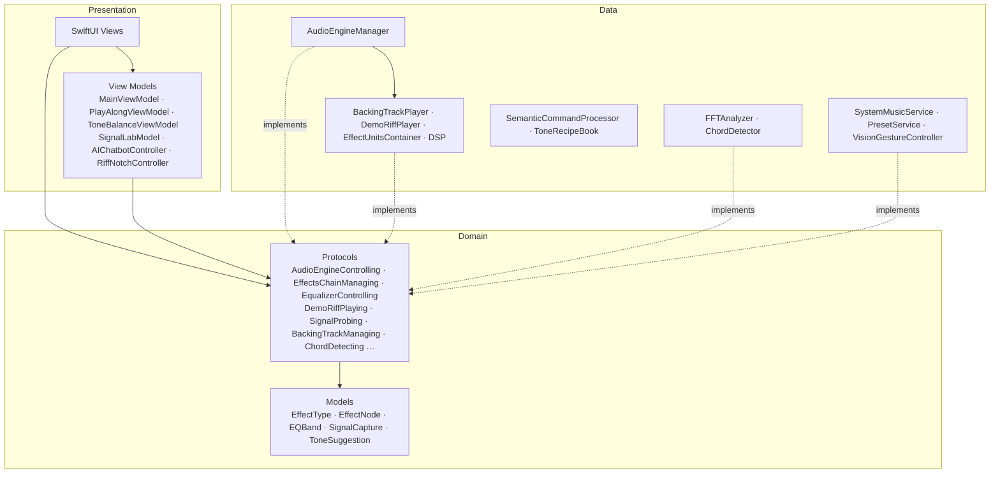

<p align="center">
  
</p>

<h1 align="center">RiffNode</h1>

<p align="center"><a href="README.md">English</a> · <b>繁體中文</b></p>

<p align="center">
  <strong>iPad 與 Mac 上「看得見」的吉他效果器。</strong><br>
  組一塊踏板、看見你的聲音、不用手就能控制 —— 全部在裝置上、全部離線。
</p>

<p align="center">
  <a href="#三分鐘上手">上手</a> ·
  <a href="#為什麼做-riffnode">為什麼做</a> ·
  <a href="#riff-notch">Riff Notch</a> ·
  <a href="#功能">功能</a> ·
  <a href="#架構">架構</a> ·
  <a href="#swift-student-challenge-2026">Swift Student Challenge</a>
</p>

<p align="center">
  <a href="#swift-student-challenge-2026"></a>
  
  
  
  
  <a href="LICENSE"></a>
</p>

<p align="center">
  
</p>

吉他效果器通常被一堆術語包圍，而且一顆就要好幾千元。RiffNode 把它變成幾分鐘內就能**看見、摸到、聽到**的東西：把踏板拖進訊號鏈、邊彈邊看波形和頻譜變化、用一句話請裝置上的 AI 調出音色，雙手不離吉他也能點頭切換 preset。

> App 內的文字為英文（Swift Student Challenge 規定作品內容需為英文）。

## 為什麼做 RiffNode

- **沒有吉他也能玩。** 內建的 demo riff 是一段原創的 J-rock 分散和弦，走 IV–V–iii–vi「王道進行」，在裝置上即時合成，從真吉他進入的位置送進踏板鏈，任何人都能聽出每顆踏板的作用。
- **隨時有伴奏。** 內建鼓加貝斯的 groove（C · D · Bm · Em、150 BPM，可換任何小調）同樣即時合成；也可以匯入自己的歌，或讓 Apple Music、Spotify 一起播放。
- **看見物理作用。** Signal Lab 即時畫出每顆踏板「進去」與「出來」的訊號 —— Distortion 削平峰值、Compressor 壓縮音量、Flanger 的梳狀濾波 —— 並用量測數字說明變化。
- **不用手也能控制。** Vision 臉部追蹤把點頭、歪頭變成切換 preset 與開關踏板，嘴巴則是一顆 wah：張得越開，共振帶通濾波器就從 350 Hz 掃到 2.2 kHz。
- **描述音色，就得到音色。** Foundation Models 聽得懂「surf rock」或「Comfortably Numb solo」，RiffNode 幫你設定好踏板，全程在裝置上，並即時顯示它的思考步驟。
- **邊聽邊學。** 效果器指南裡每一顆都有 **Hear it** 按鈕：demo riff 只經過那一顆踏板，還能和原音 A/B 比較。
- **隱私、離線。** 不需要帳號、不連網、不收集數據。音訊、相機畫面和 AI 提示都不會離開裝置。

## 三分鐘上手

| 步驟 | 怎麼做 | 你會看到 |
| --- | --- | --- |
| 1 | 點 **Get Started** 並允許麥克風 | 音訊引擎啟動，Riff Notch 亮綠燈 |
| 2 | 點 **Take the Tour**（或略過） | 簡短的訊號鏈導覽 |
| 3 | 點 **No guitar? Try the Demo Riff**（`⌘D`） | riff 經過你的踏板播放；Signal Lab、調音器、和弦偵測同時動起來 |
| 4 | 點一顆踏板，或雙擊來開關 | 聲音和頻譜立刻改變，Notch 會顯示變化 |
| 5 | 打開 **Tone Assistant**（`⌘J`），點 *Ambient pad* | 看它一步步挑踏板、設參數，再重建訊號鏈 |
| 6 | 在 Play Along 按 **Groove** 播放 | 任意小調的鼓與貝斯；目前的和弦會亮起 |
| 7 | 打開 **Gesture Control** 並點頭 | 免手切換 preset，Notch 會給回饋 |

> [!TIP]
> 把吉他接上任何 USB 錄音介面，就能即時經過同一條訊號鏈彈奏。快速測試用內建麥克風也可以。

## Riff Notch

視窗頂端有一個 Dynamic Island 風格的瀏海，iPad 和 Mac 都有。眼睛看著指板時，它也能給你回饋 —— 對頭部手勢尤其重要，否則手勢完全沒有視覺回應。

| 狀態 | 顯示內容 |
| --- | --- |
| **收合** | 引擎指示燈、即時輸入音量、正在彈的音（音準正確時變綠） |
| **彈出** | preset、踏板、手勢或引擎狀態改變時的短暫提示 |
| **展開** | 調音器、IN/OUT 電平表、開始/停止、上一個/下一個 preset、可點選開關的踏板 |

點一下或按 `⌘K` 展開。形狀、狀態與彈簧動畫參考 [NotchDrop](https://github.com/Lakr233/NotchDrop)，以單一可動畫的 SwiftUI `Shape` 重寫，讓它能在 iPad 與 Mac Catalyst 的 App Playground 中運作。

## 功能

### 即時效果器

11 種效果器，建構在 `AVAudioEngine` 上。每顆踏板都依訊號鏈順序接好，開關只是即時 bypass。Chorus、Flanger、Phaser、Tremolo，以及 Overdrive（soft clip）、Distortion（hard clip）、Fuzz 這三種削波器，都在自製的 in-process **Audio Unit** 中以真正的 DSP 運作 —— 每一顆旋鈕都會改變訊號。

| 類別 | 效果器 |
| --- | --- |
| 動態 | Compressor |
| 濾波與音高 | Parametric EQ（10 段、可拖曳曲線、14 種 preset） |
| 增益／破音 | Overdrive · Distortion · Fuzz |
| 調變 | Chorus · Phaser · Flanger · Tremolo |
| 時間與空間 | Delay · Reverb |

**14 組內建 preset**，涵蓋 Clean、Crunch、Heavy、Ambient —— 從 *Slapback Echo* 到 *Djent Machine* 和 *Shoegaze*。**Stage Mode** 把踏板變成全螢幕演出畫面，配上大型腳踏開關。

### 免手 Vision 控制

| 手勢 | 預設動作 |
| --- | --- |
| 點頭向下／向上 | 下一個／上一個 preset |
| 頭向左／右歪 | 全部關閉／全部開啟 |
| 張嘴 | Wah —— 閉嘴是 heel down（暗），張開是 toe down（亮） |
| 挑眉 | 開關 Compressor |

### 裝置上的 AI 與分析

- **Tone Assistant** —— 用一般英文聊天。點名踏板的指令（「more reverb」）在本機即時、精準處理；描述性的請求（「Comfortably Numb solo」）交給 Foundation Models，以 `@Generable` 描繪出聲音的輪廓（風格、gain、空間感、代表性踏板），再由「食譜」設定旋鈕 —— 實測模型很會辨認音樂，但直接給數字並不可靠。輸出採串流，聊天畫面會顯示模型正在做什麼。
- **Signal Lab** —— 在選取的踏板前後各裝一個 tap，顯示處理前後的波形、音量包絡和頻譜，並量測 peakiness、音量範圍、亮度和音符間的空隙。
- **Play Along** —— 內建 groove 可選任意小調與速度，會標示目前的和弦和適合 solo 的音階；也可以播自己的歌，或讓 Apple Music（iPad 上可直接控制）與 Spotify 一起播放。
- **誠實的備援** —— RiffNode 會檢查 `SystemLanguageModel.availability`。沒有 Apple Intelligence 時改由離線的音色比對回答，每則回覆都會標示是哪一個引擎回答的。
- **和弦 → 音色建議** —— 穩定按住一個和弦時，RiffNode 會建議相配的音色，一鍵即可套用。
- **調音器與 Tone balance** —— Input 卡片內有精準到 cent 的調音器與和弦偵測；EQ 分頁上方的 Tone balance 卡片會告訴你聲音主要落在哪個頻段（bass、body、mids、bite、air）、用白話解釋，並一鍵套用對應的 EQ 調整。背後是 FFT（Accelerate / vDSP）與自相關音高偵測；同一份即時頻譜也畫在 Parametric EQ 曲線後方。

### 鍵盤快捷鍵（Mac 與 iPad）

| 快捷鍵 | 動作 |
| --- | --- |
| `⌘↩` | 開始／停止引擎 |
| `⌘D` | 播放／停止 demo riff |
| `⌘←` `⌘→` | 上一個／下一個 preset |
| `⌘K` | 展開／收合 Riff Notch |
| `⌘J` | 開啟／關閉 Tone Assistant |
| `⌘1` – `⌘3` | Pedalboard · EQ & Tone · Learn |

## 畫面

<table>
  <tr>
    <td width="50%"><br><sub><b>Tone Assistant</b> —— 「surf rock」，由裝置上的 Apple Intelligence 回答</sub></td>
    <td width="50%"><br><sub><b>EQ &amp; Tone</b> —— 聲音落在哪裡，以及一鍵修正的 EQ 調整</sub></td>
  </tr>
  <tr>
    <td colspan="2"><br><sub><b>Learn</b> —— 單獨聽一顆踏板，同時看它對波形做了什麼</sub></td>
  </tr>
</table>

## 技術

| 元件 | 技術 | 用途 |
| --- | --- | --- |
| 語言 | Swift 6 | 嚴格並行檢查、`Sendable` 音訊資料 |
| UI | SwiftUI · Liquid Glass | `glassEffect`、`GlassEffectContainer`、30–60 fps 的 `Canvas` 視覺化 |
| 音訊 | AVFoundation | `AVAudioEngine`、`AVAudioUnit` 效果器、input tap、player node |
| DSP | Accelerate（vDSP） | FFT 頻譜、自相關音高偵測 |
| 視覺 | Vision | `VNDetectFaceLandmarksRequest` 偵測頭部與臉部手勢 |
| AI | Foundation Models | 裝置上的 `LanguageModelSession`，搭配 `@Generable` 音色描述 |
| 狀態 | Observation | `@Observable` 的 view model 與服務 |

### 實作重點

- **Swift 6 的音訊 tap** —— tap block 是全域、非隔離的函式，寫入有鎖保護的緩衝區，所以音訊執行緒上永遠不會跑到 `@MainActor` 的 closure。
- **啟動不卡頓** —— `AVAudioSession` 的啟用放在主執行緒之外。
- **Demo riff 與 groove** —— Karplus–Strong 撥弦合成（all-pass 校正音準、濾波過的撥弦雜訊、悶音 ghost note），加上合成的大鼓、小鼓、hi-hat 和貝斯，都用固定種子在裝置上產生 —— 沒有打包任何音檔。匯入的歌曲會用 `AVAudioConverter` 轉成引擎的取樣率。
- **即時 DSP** —— 自製的 `AUAudioUnit` 在音訊執行緒上原地處理，不配置記憶體、不用鎖；參數透過 `Synchronization.Atomic` 跨執行緒傳遞。
- **快速的裝置端 AI** —— 模型只填一個小小的 `@Generable` 輪廓（風格、gain、空間感、最多三顆代表性踏板），而不是直接給旋鈕數值；每次請求使用預熱過的新 session，在 macOS 27 的模型上約 3.5 秒回應，且不會超出 4K 的 context window。

## 架構

RiffNode 採用 **MVVM** 與 **Clean Architecture**。依賴方向一律向內：Presentation 和 Data 都只依賴 Domain，彼此不依賴對方的具體型別。



```
RiffNode.swiftpm/
├── App/                    組合根：建立引擎，切換 Welcome → Tour → Main
├── Domain/                 純 Swift（只依賴 Foundation）
│   ├── Models/             效果器、preset、EQ、訊號擷取、輸入裝置、學習內容
│   └── Protocols/          一個能力一個 protocol（引擎、踏板鏈、EQ、demo riff、訊號擷取、伴奏 …）
├── Data/
│   ├── Audio/              AudioEngineManager（音訊圖）· BackingTrackPlayer · DemoRiffPlayer
│   │                       EffectUnitsContainer · 合成器 · DSP/（自製 Audio Unit）
│   ├── Analysis/           FFTAnalyzer、ChordDetector、SignalProbe
│   ├── AI/                 SemanticCommandProcessor、ToneRecipeBook
│   ├── Playback/           SystemMusicService（Apple Music）
│   ├── Vision/ · Presets/ · Learning/
├── Presentation/
│   ├── ViewModels/         各功能的 view model + EngineRequirements（每個畫面能用的能力）
│   ├── Views/              一個功能一個資料夾：Main、Pedalboard、EQ、Learn、AI、Notch …
│   └── DesignSystem/       設計 token、玻璃元件、NotchShape、DomainColors
└── Core/Extensions/
```

- **介面隔離** —— 引擎拆成多個小的能力 protocol。每個畫面在 `EngineRequirements` 宣告它需要什麼（例如 `SignalLabEngine = AudioEngineControlling & DemoRiffPlaying & SignalProbing & EffectsChainManaging`），所以 View 碰不到其他功能。
- **依賴反轉** —— View 與 view model 持有的是 `any …` protocol 型別；只有組合根 `ContentView` 會建立 `AudioEngineManager`。
- **不依賴 UI 的 Domain** —— 顏色放在 `Presentation/DesignSystem/DomainColors.swift`，AVFoundation 的對應放在 `Data`，所以 `Domain` 只 import Foundation。
- **單一職責** —— 伴奏、demo riff、效果器 unit 都是各自的類別；功能規則（切換模式時停止什麼、Tone balance 的遲滯判斷）放在 view model，而不是 View。

## 開始使用

### 需求

- iPadOS 26 或 macOS 26（Apple silicon）
- iPad 或 Mac 上的 Swift Playgrounds，或 Xcode 26 以上
- 選用：吉他與 USB 錄音介面；手勢功能需要前鏡頭

### 執行

```bash
git clone https://github.com/RiffNode/riffnode-wwdc2026.git
open riffnode-wwdc2026/RiffNode.swiftpm
```

用 Swift Playgrounds 或 Xcode 開啟 `RiffNode.swiftpm`，在 iPad 或 **My Mac** 上執行。iPad 模擬器可以使用 demo riff；即時吉他輸入與手勢需要實機。

## Swift Student Challenge 2026

RiffNode 獲 Apple 選為 **2026 Swift Student Challenge 得獎作品** —— 全球 350 位得主之一，也是今年台灣的 8 位得主之一。

<p align="center">
  
  <br><sub>WWDC26 舞台上 —— 名單牆上的 <b>Yu-Jia, Taiwan</b></sub>
</p>

<table>
  <tr>
    <td width="50%"><br><sub>Apple 的得獎信</sub></td>
    <td width="50%"><br><sub>得獎卡片 —— <code>achievement: .winner</code></sub></td>
  </tr>
  <tr>
    <td colspan="2"><br><sub>Apple Developer 上的得獎通知</sub></td>
  </tr>
</table>

作品依照比賽規定，以 App Playground 形式製作：

- **完全離線** —— 沒有網路請求，不下載任何模型或素材。
- **三分鐘內**就能體驗核心功能，有沒有吉他都可以。
- 單一 `.swiftpm`，沒有任何第三方套件。

它把底層訊號處理、電腦視覺與裝置端 AI 結合起來，讓音樂科技成為可以親手探索的東西，而不只是讀到的知識。比賽之後仍持續開發 —— Signal Lab、Play Along 與混合式 Tone Assistant 都是賽後加入的。

### 媒體報導

| 日期 | 媒體 | 報導 |
|---|---|---|
| 2026-05-08 | 中央社 CNA | [海大梁祐嘉開發吉他效果器APP 獲蘋果WWDC學生挑戰賽獎](https://www.cna.com.tw/postwrite/chi/432895) |
| 2026-05-08 | 聯合報 | [蘋果WWDC26學生挑戰賽 海大梁祐嘉吉他APP獲獎](https://udn.com/news/story/6928/9489917) |
| 2026-05-08 | yam 蕃薯藤 | [海大梁祐嘉開發吉他效果器APP 奪蘋果WWDC26學生大獎](https://n.yam.com/Article/20260508583843) |
| 2026-05-11 | 1111 人力銀行 | [海大生開發AI吉他效果器APP 獲蘋果 WWDC學生挑戰賽](https://www.1111.com.tw/news/165780/amp/) |
| 2026-04-20 | 數位時代 | [蘋果Swift Student Challenge揭曉，台灣8人得獎！](https://www.bnext.com.tw/article/90716/swift-student-challenge) |
| 2026-04-15 | NOWnews 今日新聞 | [蘋果WWDC學生賽8台生獲獎！](https://www.nownews.com/news/6807253) |
| 2026-04-14 | T客邦 | [蘋果 WWDC26 學生挑戰賽：台灣 8 位學生獲獎](https://www.techbang.com/posts/128826-apple-wwdc26-taiwan-students-ai-ar-winners) |
| 2026-04-14 | 聯合新聞網 科技 | [蘋果WWDC 2026 Swift學生挑戰賽：台灣8名學子入圍創紀錄](https://tech.udn.com/tech/story/123153/9439619) |
| 2026-04-13 | 科技新報 | [歷年來最多！2026 WWDC Swift Student Challenge 獲獎學生達 8 位](https://technews.tw/2026/04/13/2026-wwdc-swift-student-challenge-taiwan/) |

## 致謝

- Lakr Aream 的 [NotchDrop](https://github.com/Lakr233/NotchDrop)（MIT）—— 瀏海形狀、狀態與彈簧動畫的靈感來源。
- 效果器的歷史與訊號鏈知識取材自常見的吉他器材知識，為本專案重新撰寫。

## 授權

RiffNode 以 [MIT 授權](LICENSE) 釋出。

<p align="center">
  由梁祐嘉（Jesse）用 ❤️ 和無數次的回授製作
</p>
