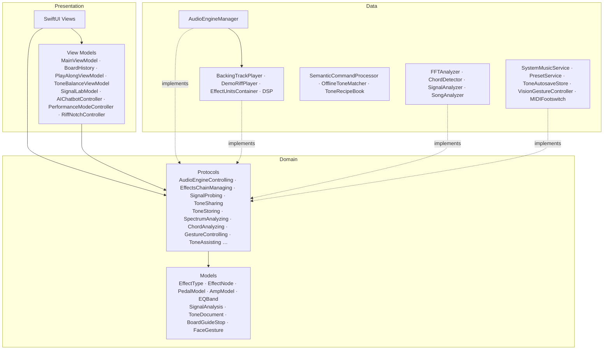

<p align="center">
  
</p>

<h1 align="center">RiffNode</h1>

<p align="center"><a href="README.md">English</a> · <b>繁體中文</b></p>

<p align="center">
  <strong>iPad 與 Mac 上「看得見」的吉他效果器。</strong><br>
  組一塊踏板、看見你的聲音、不用手就能控制 —— 全部在裝置上、全部離線。
</p>

<p align="center">
  <a href="#三分鐘上手">上手</a> ·
  <a href="#為什麼做-riffnode">為什麼做</a> ·
  <a href="#riff-notch">Riff Notch</a> ·
  <a href="#功能">功能</a> ·
  <a href="#架構">架構</a> ·
  <a href="#swift-student-challenge-2026">Swift Student Challenge</a>
</p>

<p align="center">
  <a href="#swift-student-challenge-2026"></a>
  
  
  
  
  <a href="LICENSE"></a>
</p>

<p align="center">
  
</p>

吉他效果器通常被一堆術語包圍，而且一顆就要好幾千元。RiffNode 把它變成幾分鐘內就能**看見、摸到、聽到**的東西：把踏板拖進訊號鏈、邊彈邊看波形和頻譜變化、用一句話請裝置上的 AI 調出音色，雙手不離吉他也能點頭切換 preset。

> App 內的文字為英文（Swift Student Challenge 規定作品內容需為英文）。

## 為什麼做 RiffNode

- **沒有吉他也能玩。** Demo 可播放原創的 J-rock 合成分散和弦，或匯入你自己彈的 clean 錄音（可一次匯入多段，在 Input 卡片切換），從踏板前端送入。Demo 不需要麥克風權限；踏板預設關閉，也能整組旁通，比較前後而保留設定。
- **隨時有伴奏。** 內建鼓加貝斯的 groove（C · D · Bm · Em、150 BPM，可換任何小調）同樣即時合成；也可以匯入自己的歌，或讓 Apple Music、Spotify 一起播放。
- **一塊免費、行為像真的效果器盤。** 彩色的實體效果器從吉他輸入一路接到音箱和喇叭箱，順序和真實玩家一樣 —— 排序不尋常時，RiffNode 會解釋它對聲音的影響。連導線都有模擬：線越長，高頻越悶。
- **看見物理作用。** Signal Lab 即時畫出每顆踏板「進去」與「出來」的訊號 —— Distortion 削平峰值、Compressor 壓縮音量、Flanger 的梳狀濾波 —— 並用量測數字說明變化。
- **不用手也能控制。** Vision 臉部追蹤把點頭、歪頭變成切換 preset 與開關踏板，嘴巴則是一顆 wah：張得越開，共振帶通濾波器就從 350 Hz 掃到 2.2 kHz。
- **描述音色，就得到音色。** Foundation Models 聽得懂「surf rock」或「Comfortably Numb solo」，RiffNode 幫你設定好踏板，全程在裝置上，並即時顯示它的思考步驟。
- **邊聽邊學。** 效果器指南裡每一顆都有 **Hear it** 按鈕：demo riff 只經過那一顆踏板，還能和原音 A/B 比較。
- **隱私、離線。** 不需要帳號、不連網、不收集數據。音訊、相機畫面和 AI 提示都不會離開裝置。

## 三分鐘上手

| 步驟 | 怎麼做 | 你會看到 |
| --- | --- | --- |
| 1 | 點 **Try the Demo Riff**，或用 **Connect a Guitar** 接實體吉他 | 引擎啟動；只有實體輸入會要求麥克風權限 |
| 2 | 點 **Take the Tour**（或略過） | 簡短的訊號鏈導覽 |
| 3 | Input 選 Demo：原創分散和弦，或用 **Import Recordings…** 匯入自己的錄音（`⌘D` 播放／停止） | 開一顆踏板，再用 **Bypass pedals to compare** 比較同一段演奏 |
| 4 | 點一顆踏板，或雙擊來開關 | 聲音和頻譜立刻改變，Notch 會顯示變化 |
| 5 | 打開 **Tone Assistant**（`⌘J`），點 *Ambient pad* | 看它一步步挑踏板、設參數，再重建訊號鏈 |
| 6 | 在 Play Along 按 **Groove** 播放 | 任意小調的鼓與貝斯；目前的和弦會亮起 |
| 7 | 打開 **Gesture Control** 並點頭 | 免手切換 preset，Notch 會給回饋 |

> [!TIP]
> 把吉他接上任何 USB 錄音介面，就能即時經過同一條訊號鏈彈奏。快速測試用內建麥克風也可以。

## Riff Notch

視窗頂端有一個 Dynamic Island 風格的瀏海，iPad 和 Mac 都有。眼睛看著指板時，它也能給你回饋 —— 對頭部手勢尤其重要，否則手勢完全沒有視覺回應。

| 狀態 | 顯示內容 |
| --- | --- |
| **收合** | 引擎指示燈、即時輸入音量、正在彈的音（音準正確時變綠） |
| **彈出** | preset、踏板、手勢或引擎狀態改變時的短暫提示 |
| **展開** | 調音器、IN/OUT 電平表、開始/停止、上一個/下一個 preset、可點選開關的踏板 |

點一下或按 `⌘K` 展開。形狀、狀態與彈簧動畫參考 [NotchDrop](https://github.com/Lakr233/NotchDrop)，以單一可動畫的 SwiftUI `Shape` 重寫，讓它能在 iPad 與 Mac Catalyst 的 App Playground 中運作。

## 功能

### 即時效果器

11 種效果器，建構在 `AVAudioEngine` 上。每顆踏板都依訊號鏈順序接好，開關只是即時 bypass。Chorus、Flanger、Phaser、Tremolo、類比風格的 Delay，以及 Overdrive（soft clip）、Distortion（hard clip）、Fuzz 這三種削波器，都在自製的 in-process **Audio Unit** 中以真正的 DSP 運作 —— 每一顆旋鈕都會改變訊號。

效果器盤的配置和真的一樣：**吉他 → 輸入級 → 踏板 → 音箱 → 喇叭箱**。

| 階段 | 模擬的內容 |
| --- | --- |
| 吉他與導線 | 拾音器（約 2.5 H）與導線（每英尺約 30 pF）形成共振低通，f = 1/(2π√LC)：3 英尺在 7.3 kHz 以上滾降，60 英尺降到 2.3 kHz。效果器盤前端的 buffer 可以保住高頻；另有音量踏板與 noise gate |
| 踏板 | 可拖曳排序；遇到不尋常的順序（時間類效果放在破音前、fuzz 不在第一顆……）會提示並解釋對聲音的影響，一鍵排回標準順序 |
| 音箱 | 五台經典音箱，加上現代高增益與 Neural Amp Modeler：不對稱的真空管前級、依原電路放在前級之前或之後的 Bass／Mid／Treble 音色控制、後級飽和 |
| 喇叭箱 | 1×12、2×12、4×12 喇叭模型 —— 5 kHz 以上的滾降讓刺耳的破音變成吉他音色 —— 也可以載入自己的 **IR 檔**（.wav），即時卷積 |

| 類別 | 效果器 |
| --- | --- |
| 動態 | Compressor |
| 濾波與音高 | Parametric EQ（10 段、可拖曳曲線、14 種 preset） |
| 增益／破音 | Overdrive · Distortion · Fuzz |
| 調變 | Chorus · Phaser · Flanger · Tremolo |
| 時間與空間 | Delay · Reverb |

**14 組內建 preset**，涵蓋 Clean、Crunch、Heavy、Ambient —— 從 *Slapback Echo* 到 *Djent Machine* 和 *Shoegaze*。**Stage Mode** 是現場演出用的踏板盤，配置照真的來：鋁條板面、吉他從右邊接入、左邊接到音箱、第一顆是調音器（調音時靜音）、直角插頭的跳線、從板子下方電源拉上來的 9V 線 —— 所有踏板一次排滿畫面，點一下就踩。preset 名稱遠遠就看得清楚，下方有 Looper、整組旁通與調音靜音；觸控、鍵盤、MIDI 腳踏或頭部手勢都能控制，演出時螢幕不會變暗。

### 經典效果器與音箱

20 顆經典踏板與 5 台經典音箱，依原版電路的運作方式調出聲音：Tube Screamer 式的中頻隆起、Blues Driver 開闊又不對稱的削波、Big Muff 挖空中頻的厚重 fuzz。點踏板名稱就能換成同類的其他經典款；三個破音位置可以放任何一顆破音，像真的踏板盤一樣疊兩顆 overdrive。

| RiffNode 踏板 | 參考的原版 | 電路的作用 |
| --- | --- | --- |
| Tube Steamer | Ibanez TS808 Tube Screamer | 約 720 Hz 以上軟削波、低頻乾聲混回：中頻推力 |
| Blue Diver | Boss BD-2 Blues Driver | 不對稱的分離式削波、低頻切得少：開闊、像音箱的破音 |
| Copper Pegasus | Klon Centaur | 乾聲與鍺二極體削波路徑混合：透明的推升，越推越毛 |
| Compulsive Drive | Fulltone OCD | MOSFET 柔和膝點，保留撥弦起音 |
| Sunny Drive | Boss SD-1 | 不對稱二極體：較亮的 Tube Screamer 近親 |
| The Mouse | ProCo RAT | 約 60 dB 運放增益、硬削波、反向的 filter |
| Dirt Station | Boss DS-1 | 硬削波加上挖空中頻的音色控制 |
| Plus Sign | MXR Distortion+ | 鍺二極體、沒有音色旋鈕 |
| Heavy Mettle | Boss HM-2 | 兩級增益與挖空中頻的 EQ：「電鋸」聲 |
| Fuzz Grin | Arbiter Fuzz Face | 兩顆電晶體、不對稱削波，吉他音量轉小就變乾淨 |
| Big Fluff | Electro-Harmonix Big Muff Pi | 兩級削波與挖中頻的音色 |
| Dino Comp | MXR Dyna Comp | 快速起音的壓縮，鄉村 chicken-pickin' |
| Cloud Ensemble | Boss CE-2 | BBD 合唱 |
| Orange Ninety | MXR Phase 90 | 四級 all-pass、一顆速度旋鈕 |
| Uni-Wave | Shin-ei Uni-Vibe | 不一致的相位級與像燈泡般起伏的掃動 |
| Electric Mystery | Electro-Harmonix Electric Mistress | 慢速、短延遲的鑲邊 |
| Tremor Two | Boss TR-2 | 從正弦到方波的音量顫動 |
| Carbon Paper | MXR Carbon Copy | 類比延遲：每次重複更暗更暖 |
| Digital Dee | Boss DD-3 | 乾淨穩定的數位重複 |
| Holy Pail | Electro-Harmonix Holy Grail | 一顆旋鈕的殘響 |

| RiffNode 音箱 | 參考的原版 | 個性 |
| --- | --- | --- |
| Twain '65 | Fender Twin Reverb（blackface） | 音色控制在破音前、中頻凹陷、bright 電容、超大動態空間 |
| Tweedle '59 | Fender Bassman 5F6-A（tweed） | 中頻飽滿、很早開始破 |
| Top Boost 30 | Vox AC30 Top Boost | 清脆的 A 類中高頻 |
| Plexus 100 | Marshall 1959 Super Lead（plexi） | 音色控制在前級之後：中頻穿透破音 |
| Brit 800 | Marshall JCM800 2203 | 串接前級：緊實的 80 年代搖滾 |

踏板與音箱的名稱、面板與外殼都是 RiffNode 原創，沒有使用任何 Logo 或複製圖案。提到原版型號只是為了說明聲音；所有商標屬於其擁有者，RiffNode 與它們沒有任何關係，也未獲得背書。

### 免手 Vision 控制

| 手勢 | 預設動作 |
| --- | --- |
| 點頭向下／向上 | 下一個／上一個 preset |
| 頭向左／右歪 | 全部關閉／全部開啟 |
| 張嘴 | Wah —— 閉嘴是 heel down（暗），張開是 toe down（亮） |
| 挑眉 | 開關 Compressor（Stage Mode 中為瞬間增益） |

### 裝置上的 AI 與分析

- **Tone Assistant** —— 用一般英文聊天。點名踏板的指令（「more reverb」）在本機即時、精準處理；描述性的請求（「Comfortably Numb solo」）交給 Foundation Models，以 `@Generable` 描繪出聲音的輪廓（風格、gain、空間感、代表性踏板），再由「食譜」設定旋鈕 —— 實測模型很會辨認音樂，但直接給數字並不可靠。輸出採串流，聊天畫面會顯示模型正在做什麼。
- **Learn** —— 四個章節，從大卡片挑選。*組一塊踏板盤* 帶你走過真實踏板盤的每個部分：吉他導線、調音器、buffer、踏板順序、跳線、電源、音箱；可以拖動導線長度看拾音器截止頻率變化、計算你自己踏板的耗電，並看到串接電源造成的接地迴路雜音。*踏板圖鑑* 把二十顆經典做成擬真踏板，可以試聽（與乾聲 A/B）並放上踏板盤；*效果器類型* 與 *聲音科學* 解說各家族與背後的物理。
- **Signal Lab** —— 在選取的踏板前後各裝一個 tap，顯示處理前後的波形、音量包絡和頻譜，並量測 peakiness、音量範圍、亮度和音符間的空隙。
- **Play Along** —— 內建 groove 可選任意小調與速度，會標示目前的和弦和適合 solo 的音階；也可以播自己的歌，或讓 Apple Music（iPad 上可直接控制）與 Spotify 一起播放。
- **誠實的備援** —— RiffNode 會檢查 `SystemLanguageModel.availability`。沒有 Apple Intelligence 時改由離線的音色比對回答，每則回覆都會標示是哪一個引擎回答的。
- **和弦 → 音色建議** —— 穩定按住一個和弦時，RiffNode 會建議相配的音色，一鍵即可套用。
- **調音器與 Tone balance** —— Input 卡片內有精準到 cent 的調音器與和弦偵測；EQ 分頁上方的 Tone balance 卡片會告訴你聲音主要落在哪個頻段（bass、body、mids、bite、air）、用白話解釋，並一鍵套用對應的 EQ 調整。背後是 FFT（Accelerate / vDSP）與自相關音高偵測；同一份即時頻譜也畫在 Parametric EQ 曲線後方。

### 練習、分享與現場控制

- **低延遲** —— 約 5 ms 的 I/O 緩衝區，設定頁顯示實測的「弦到耳朵」延遲；使用藍牙耳機（多 100–200 ms）時會提醒。
- **復原與自動儲存** —— 踏板盤的每次修改（踏板、順序、型號、旋鈕、音箱、EQ，以及前面的導線、buffer 和 noise gate）在停止變動後成為一個復原步驟，拖一次旋鈕只算一步；踏板盤會自動儲存，下次開啟就回來。
- **同款疊兩顆** —— 疊兩顆 overdrive，或一短一長兩顆 delay：同類型的第二顆以後各有自己的音訊單元，Signal Lab 也只擷取你選的那一顆。
- **Looper** —— 一顆踩踏開關：錄音、播放、疊錄、undo。錄的是音箱輸出，所以只會疊上你的吉他。
- **節拍器** —— 第一拍重音，可一鍵對齊 groove 的速度。
- **Neural Amp Modeler** —— 載入真實音箱的 `.nam` 擷取檔。以 Accelerate 移植 NeuralAmpModelerCore 的 WaveNet，同時支援原始的 A1 與新的 A2 擷取檔（可縮放容器 —— 使用完整大小的模型 —— 加上每層不同的 kernel、LeakyReLU 與時間向的 head）。逐樣本與參考實作比對：訊雜比 132–135 dB、即時速度的 13–22 倍。點踏板盤最右邊的音箱，選 **Load a NAM capture…**；實驗性選項（FiLM 調變、層內縮放）會明確提示不支援，不會播放錯誤的聲音。
- **分享音色** —— 把踏板、音箱與 EQ 匯出成小小的 JSON 檔，或匯入別人的。
- **MIDI 踏板** —— USB 或藍牙 MIDI 踏板：Program Change 切換 preset；CC 80/81 下一個／上一個、CC 82 looper、CC 83 靜音。
- **iOS / macOS 27** —— 匯入的歌曲用 Music Understanding framework 在裝置上分析（調性、速度、段落、solo 音階）；Tone Assistant 也能透過 Foundation Models 的圖片輸入，從照片建議音色。

### 無障礙

- 文字跟著系統字級（Dynamic Type）縮放；踏板與音箱的繪圖保持實體硬體的固定大小，固定尺寸的控制項最大放到特大。
- 「減少動態效果」會讓動態背景與指示停住；「降低透明度」會拿掉玻璃後方的彩色光球；「增加對比」讓玻璃卡片有清楚的邊框。
- 旋鈕可以用 VoiceOver 上下滑動調整；踏板、調音器與 Stage Mode 的腳踏開關都有語音標籤與數值。
- **聽得到的圖表** —— EQ 曲線、拾音器與導線的頻率響應，以及 Signal Lab 的前後對照圖，都會把自己描述成圖表（`AXChartDescriptor`）。VoiceOver 會讀出座標軸與摘要（例如「boost 3 dB at 1.0 kHz」），可以逐點查看數值，也能用 Audio Graph 把曲線播成高低起伏的音調。
- EQ 的每個頻段都是一個 VoiceOver 元素：上下滑動調整增益，用「Raise / Lower frequency」動作一次移動三分之一個八度。

### 鍵盤快捷鍵（Mac 與 iPad）

| 快捷鍵 | 動作 |
| --- | --- |
| `⌘↩` | 開始／停止引擎 |
| `⌘D` | 播放／停止 demo riff |
| `⌘←` `⌘→` | 上一個／下一個 preset |
| `⌘K` | 展開／收合 Riff Notch |
| `⌘J` | 開啟／關閉 Tone Assistant |
| `⌘1` – `⌘3` | Pedalboard · EQ & Tone · Learn |
| `⌘Z` · `⇧⌘Z` | 復原 · 重做踏板盤的任何修改 |
| `⌃⌘S` | 顯示或隱藏側欄 |
| `1` – `9` | Stage Mode：踩第 1–9 顆踏板 |
| `←` `→` · `L` · `B` · `T` · `Esc` | Stage Mode：preset · Looper · 整組旁通 · 調音靜音 · 離開 |

## 畫面

<table>
  <tr>
    <td width="50%"><br><sub><b>Tone Assistant</b> —— 「surf rock」，由裝置上的 Apple Intelligence 回答</sub></td>
    <td width="50%"><br><sub><b>EQ &amp; Tone</b> —— 聲音落在哪裡，以及一鍵修正的 EQ 調整</sub></td>
  </tr>
  <tr>
    <td><br><sub><b>音箱與喇叭箱</b> —— 把破音的沙沙聲濾掉的喇叭</sub></td>
    <td><br><sub><b>吉他與導線</b> —— 量得到的 tone suck：f = 1/(2π√LC)</sub></td>
  </tr>
  <tr>
    <td><br><sub><b>踏板圖鑑</b> —— 二十顆經典：看電路、聽聲音、放上你的踏板盤</sub></td>
    <td><br><sub><b>Stage Mode</b> —— 真的踏板盤：調音器在前、跳線、電源，點一下就踩</sub></td>
  </tr>
  <tr>
    <td colspan="2"><br><sub><b>組一塊踏板盤</b> —— 真實的踏板盤，一次認識一個部分</sub></td>
  </tr>
</table>

## 技術

| 元件 | 技術 | 用途 |
| --- | --- | --- |
| 語言 | Swift 6 | 嚴格並行檢查、`Sendable` 音訊資料 |
| UI | SwiftUI · Liquid Glass | `glassEffect`、`GlassEffectContainer`、30–60 fps 的 `Canvas` 視覺化 |
| 音訊 | AVFoundation | `AVAudioEngine`、`AVAudioUnit` 效果器、input tap、player node |
| DSP | Accelerate（vDSP） | FFT 頻譜、自相關音高偵測 |
| 視覺 | Vision | `VNDetectFaceLandmarksRequest` 偵測頭部與臉部手勢 |
| AI | Foundation Models | 裝置上的 `LanguageModelSession`，搭配 `@Generable` 音色描述 |
| 狀態 | Observation | `@Observable` 的 view model 與服務 |

### 實作重點

- **Swift 6 的音訊 tap** —— tap block 是全域、非隔離的函式，寫入有鎖保護的緩衝區，所以音訊執行緒上永遠不會跑到 `@MainActor` 的 closure。
- **啟動不卡頓** —— `AVAudioSession` 的啟用放在主執行緒之外。
- **Demo riff 與 groove** —— Karplus–Strong 撥弦合成（all-pass 校正音準、濾波過的撥弦雜訊、悶音 ghost note），加上合成的大鼓、小鼓、hi-hat 和貝斯，都用固定種子在裝置上產生；App 不內含任何音檔；Demo 匯入的 clean 錄音與 Play Along 的歌曲會用 `AVAudioConverter` 轉成引擎的取樣率。
- **即時 DSP** —— 自製的 `AUAudioUnit` 在音訊執行緒上原地處理，不配置記憶體、不用鎖；旋鈕數值透過 `Synchronization.Atomic` 跨執行緒傳遞。音箱的濾波器係數與喇叭箱 IR 在主執行緒寫進兩組緩衝區的其中一組；音訊執行緒會先標記自己正在讀哪一組、再確認它仍是目前那組，所以主執行緒不會改寫正在被讀的那組，即使同一個音訊區塊內連續改兩次設定也一樣。壓力測試在讀取端同時運作下切換 20 萬次，確認沒有任何一次讀到寫到一半的資料。
- **低延遲** —— I/O buffer 約 5 ms（48 kHz 下 256 個取樣）；Settings 顯示實測的來回延遲（輸入＋輸出延遲＋兩個 buffer），輸出為藍牙時提醒會多 100–200 ms。踏板一直接在圖上，以 `shouldBypassEffect` 切換，開關時不重建音訊圖。
- **實測的效能餘裕** —— `scripts/bench-audio.sh` 以 128 個取樣的 buffer 渲染一個有 11 個 DSP 階段的踏板盤（輸入級、wah、三顆破音、四顆調變、類比延遲、音箱）。在 M1 Pro 上約為即時速度的 59 倍（單核心的 1.7%）；加上一個標準 A1 NAM 擷取模型約再多 5%（即時速度的 20 倍）。就算是第 99.9 百分位的 buffer，也只用掉 2.67 ms 預算中不到 0.5 ms。
- **主執行緒保持空閒** —— 音高與和弦偵測在 main actor 之外執行（以 `vDSP_dotpr` 向量化）；每次結果帶有世代編號，重設或切換音源後才完成的舊結果會被丟棄，不會覆蓋新狀態。FFT 緩衝區只配置一次，不是每一幀配置。
- **乾淨的削波** —— overdrive、distortion、fuzz 的削波以 4 倍 oversampling 運算，超過 Nyquist 的諧波不會折回成刺耳的 aliasing。
- **喇叭箱 IR** —— 載入的檔案用 `AVAudioConverter` 重新取樣、截成 2048 tap、依峰值正規化，再用 `vDSP_conv` 卷積。
- **快速的裝置端 AI** —— 模型只填一個小小的 `@Generable` 輪廓（風格、gain、空間感、最多三顆代表性踏板），而不是直接給旋鈕數值；每次請求使用預熱過的新 session，在 macOS 27 的模型上約 3.5 秒回應，且不會超出 4K 的 context window。

## 架構

RiffNode 採用 **MVVM** 與 **Clean Architecture**。依賴方向一律向內：Presentation 和 Data 都只依賴 Domain，彼此不依賴對方的具體型別。



```
RiffNode.swiftpm/
├── App/                    AppDependencies（只持有 protocol）與 live() 工廠（組合根，唯一會寫出
│                           Data 具體型別的地方），以及 ContentView（Welcome → Tour → Main）
├── Domain/                 純 Swift（只用 Foundation）
│   ├── Models/             效果器、經典踏板與音箱、preset、EQ、訊號分析、音色檔、
│   │                       踏板盤導覽、手勢，以及小型純規則（踏板順序、套用型號）
│   └── Protocols/          一個能力一個 protocol：音訊（引擎、踏板鏈、EQ、擷取、分享…）、
│                           互動（分析、手勢、Tone Assistant）與學習
├── Data/
│   ├── Audio/              AudioEngineManager（音訊圖）依職責拆成擴充檔（+AmpAndInput、
│   │                       +ChainSync、+PedalUnits、+SignalProbe…）· 播放器 · EffectUnitsContainer · DSP/
│   ├── Analysis/           FFTAnalyzer、ChordDetector、SignalProbe、SignalAnalyzer、SongAnalyzer
│   ├── AI/                 SemanticCommandProcessor、OfflineToneMatcher、ToneRecipeBook、ToneModels
│   ├── Playback/ · MIDI/ · Vision/ · Presets/（含自動儲存）· Learning/ · Logging
├── Presentation/
│   ├── ViewModels/         各功能的 view model + EngineRequirements（每個畫面能用什麼）
│   ├── Views/              一個功能一個資料夾：Main、Pedalboard、Performance、EQ、Learn、AI…
│   └── DesignSystem/       Tokens、玻璃卡片、按鈕、旋鈕、分頁列、背景、版面、DomainColors
└── Core/Extensions/
```

- **介面隔離** —— 引擎拆成多個小的能力 protocol。每個畫面在 `EngineRequirements` 宣告它需要什麼（例如 `SignalLabEngine = AudioEngineControlling & DemoRiffPlaying & SignalProbing & EffectsChainManaging`），所以 View 碰不到其他功能。
- **依賴反轉** —— View 與 view model 持有的是 `any …` protocol 型別。`AppDependencies` 只持有 protocol；它的 `live()` 工廠方法獨立成一個檔案，是唯一會寫出 Data 層具體型別的地方（預覽也透過它取得）。所以 `MainViewModel` 在測試裡可以用假的實作來跑，不需要音訊引擎、相機或 MIDI；`BoardHistory` 也只把踏板盤看成 `ToneSharing`、把儲存看成 `ToneStoring`。
- **不依賴 UI 的 Domain** —— 顏色放在 `Presentation/DesignSystem/DomainColors.swift`，AVFoundation 的對應放在 `Data`，所以 `Domain` 只 import Foundation。
- **單一職責** —— 伴奏、demo riff、效果器 unit、訊號分析、離線音色比對都是各自的型別；功能規則（切換模式時停止什麼、Tone balance 的遲滯判斷、復原）放在 view model，踏板盤規則（套用經典踏板、踏板順序建議）放在 Domain —— View 只負責呈現與轉交使用者的意圖。
- **開放封閉** —— 新增一顆經典踏板或音箱只是新增資料（一筆帶聲音參數與外觀的 `PedalModel`／`AmpVoice`），DSP 與繪圖程式都不用改。

## 開始使用

### 需求

- iPadOS 26 或 macOS 26（Apple silicon）
- iPad 或 Mac 上的 Swift Playgrounds，或 Xcode 26 以上
- 選用：吉他與 USB 錄音介面；手勢功能需要前鏡頭

### 執行

```bash
git clone https://github.com/RiffNode/riffnode-wwdc2026.git
open riffnode-wwdc2026/RiffNode.swiftpm
```

用 Swift Playgrounds 或 Xcode 開啟 `RiffNode.swiftpm`，在 iPad 或 **My Mac** 上執行。iPad 模擬器可以使用 demo riff；即時吉他輸入與手勢需要實機。

## Swift Student Challenge 2026

RiffNode 獲 Apple 選為 **2026 Swift Student Challenge 得獎作品** —— 全球 350 位得主之一，也是今年台灣的 8 位得主之一。

<p align="center">
  
  <br><sub>WWDC26 舞台上 —— 名單牆上的 <b>Yu-Jia, Taiwan</b></sub>
</p>

<p align="center">
  
  <br><sub>Apple Park，加州 Cupertino · WWDC26，2026 年 6 月 8 日 —— 今年全體得獎者的名單牆</sub>
</p>

<table>
  <tr>
    <td width="50%"><br><sub>Apple 的得獎信</sub></td>
    <td width="50%"><br><sub>得獎卡片 —— <code>achievement: .winner</code></sub></td>
  </tr>
  <tr>
    <td colspan="2"><br><sub>Apple Developer 上的得獎通知</sub></td>
  </tr>
</table>

### 獎品


2026 年的每位得主都獲得：

- Apple 的**個人化得獎證書**
- **一年** Apple Developer Program 個人會員
- **AirPods Max 2**
- 受邀申請參加 6 月 8 日揭開 WWDC26 序幕的 **Apple Park 特別活動**

<br clear="right">

### 比賽規則與 RiffNode 的對應

| 規則 | RiffNode |
| --- | --- |
| 個人作品，**App Playground**（`.swiftpm`）壓縮後 **25 MB 以內** | 原始投稿使用單一 `.swiftpm`，riff、伴奏、鼓聲皆即時合成，沒有模型；目前版本仍不內含音檔，Demo 錄音由使用者自行匯入 |
| **完全離線**（評審時網路關閉） | 沒有網路請求；Apple Intelligence 在裝置上執行，並有離線備援 |
| **三分鐘內**可以體驗完 | 第一個畫面就能使用 demo riff、Signal Lab 與 Tone Assistant |
| 使用 **Swift Playgrounds 4.6+ 或 Xcode 26+** 製作 | Swift 6、SwiftUI、iPadOS / macOS 26 |
| App 內文字與書面回答使用**英文** | App 內所有文字皆為英文 |

它把底層訊號處理、電腦視覺與裝置端 AI 結合起來，讓音樂科技成為可以親手探索的東西，而不只是讀到的知識。比賽之後仍持續開發 —— Signal Lab、Play Along 與混合式 Tone Assistant 都是賽後加入的。

### 媒體報導

| 日期 | 媒體 | 報導 |
|---|---|---|
| 2026-05-08 | 中央社 CNA | [海大梁祐嘉開發吉他效果器APP 獲蘋果WWDC學生挑戰賽獎](https://www.cna.com.tw/postwrite/chi/432895) |
| 2026-05-08 | 聯合報 | [蘋果WWDC26學生挑戰賽 海大梁祐嘉吉他APP獲獎](https://udn.com/news/story/6928/9489917) |
| 2026-05-08 | yam 蕃薯藤 | [海大梁祐嘉開發吉他效果器APP 奪蘋果WWDC26學生大獎](https://n.yam.com/Article/20260508583843) |
| 2026-05-11 | 1111 人力銀行 | [海大生開發AI吉他效果器APP 獲蘋果 WWDC學生挑戰賽](https://www.1111.com.tw/news/165780/amp/) |
| 2026-04-20 | 數位時代 | [蘋果Swift Student Challenge揭曉，台灣8人得獎！](https://www.bnext.com.tw/article/90716/swift-student-challenge) |
| 2026-04-15 | NOWnews 今日新聞 | [蘋果WWDC學生賽8台生獲獎！](https://www.nownews.com/news/6807253) |
| 2026-04-14 | T客邦 | [蘋果 WWDC26 學生挑戰賽：台灣 8 位學生獲獎](https://www.techbang.com/posts/128826-apple-wwdc26-taiwan-students-ai-ar-winners) |
| 2026-04-14 | 聯合新聞網 科技 | [蘋果WWDC 2026 Swift學生挑戰賽：台灣8名學子入圍創紀錄](https://tech.udn.com/tech/story/123153/9439619) |
| 2026-04-13 | 科技新報 | [歷年來最多！2026 WWDC Swift Student Challenge 獲獎學生達 8 位](https://technews.tw/2026/04/13/2026-wwdc-swift-student-challenge-taiwan/) |

## 未來規劃

- 音訊路由變更與中斷（拔掉錄音介面、來電）後完整恢復
- 分析 tap 與介面之間改用無鎖 ring buffer
- 手勢（Vision）相機在不同畫面間的生命週期
- 輸入端設定（導線、buffer、gate）也一起存進踏板盤
- EQ 曲線依實際濾波器響應繪製
- 長伴奏串流播放，並與節拍器、Looper 同步

## 致謝

- Lakr Aream 的 [NotchDrop](https://github.com/Lakr233/NotchDrop)（MIT）—— 瀏海形狀、狀態與彈簧動畫的靈感來源。
- Steven Atkinson 的 [NeuralAmpModelerCore](https://github.com/sdatkinson/NeuralAmpModelerCore)（MIT）—— RiffNode 的 WaveNet 移植所依循、並用來比對驗證的參考實作。
- 效果器的歷史與訊號鏈知識取材自常見的吉他器材知識，為本專案重新撰寫。

## 授權

RiffNode 原始碼以 [MIT 授權](LICENSE) 釋出。App 不內含任何第三方音檔。

<p align="center">
  由梁祐嘉（Jesse）用 ❤️ 和無數次的回授製作
</p>

## 核心回歸驗證

在裝有 Xcode 的 Mac 執行 `scripts/test-core.sh`，驗證音高、FFT、電平、AI 參數修改、舊訊息快照與免麥克風 setup。`scripts/test-audio.sh` 以離線音訊圖驗證 44.1／48 kHz 的 clean／加踏板差異、原創合成 riff，以及高競爭下的係數緩衝區交接。`scripts/test-viewmodels.sh` 用假的實作驗證 `MainViewModel`：腳踏開關事件、頭部手勢、preset 循環切換、取樣率傳遞、還原上次的踏板盤，以及 Learn 試聽不會進入復原紀錄。設定 `RIFFNODE_TEST_RECORDING` 為自己的 WAV，就能用自己的錄音跑音訊檢查。`scripts/bench-audio.sh [capture.nam]` 會量測 DSP 佔即時預算的比例。
