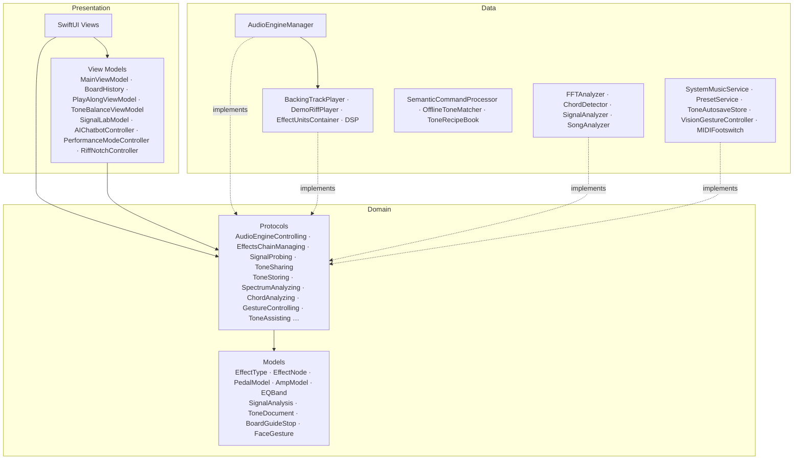

# RiffNode · Architecture

<p><b>English</b> · <a href="ARCHITECTURE.zh-TW.md">繁體中文</a> · <a href="../README.md">← README</a></p>

How RiffNode is built: the layers, how the audio stays real-time safe, and how it's tested.

## Architecture

RiffNode follows **MVVM** inside a **Clean Architecture** layout. Dependencies point inward: Presentation and Data both depend on Domain, never on each other's concrete types.



```
RiffNode.swiftpm/
├── App/                    AppDependencies (protocols only) and its live() factory – the composition
│                           root, the only place that names concrete Data types – and ContentView
├── Domain/                 Pure Swift (Foundation only)
│   ├── Models/             Effects, classic pedals & amps, presets, EQ, signal analysis, tone files,
│   │                       the board guide, gestures – plus small pure rules (pedal order, use a model)
│   └── Protocols/          One protocol per capability: audio (engine, chain, EQ, probe, sharing …),
│                           interaction (analysis, gestures, Tone Assistant) and learning
├── Data/
│   ├── Audio/              AudioEngineManager (graph) split by concern (+AmpAndInput, +ChainSync,
│   │                       +PedalUnits, +SignalProbe …) · players · EffectUnitsContainer · DSP/
│   ├── Analysis/           FFTAnalyzer, ChordDetector, SignalProbe, SignalAnalyzer, SongAnalyzer
│   ├── AI/                 SemanticCommandProcessor, OfflineToneMatcher, ToneRecipeBook, ToneModels
│   ├── Playback/ · MIDI/ · Vision/ · Presets/ (incl. autosave) · Learning/ · Logging
├── Presentation/
│   ├── ViewModels/         Feature view models + EngineRequirements (what each screen may use)
│   ├── Views/              One folder per feature: Main, Pedalboard, Performance, EQ, Learn, AI …
│   └── DesignSystem/       Tokens, glass card, buttons, knob, tab bar, background, layout, DomainColors
└── Core/Extensions/
```

- **Interface segregation** – the engine is exposed as small capability protocols. Each screen declares what it needs in `EngineRequirements` (for example `SignalLabEngine = AudioEngineControlling & DemoRiffPlaying & SignalProbing & EffectsChainManaging`), so a view can't reach anything else.
- **Dependency inversion** – views and view models hold `any …` protocol types. `AppDependencies` holds only protocols; its `live()` factory, in a file of its own, is the one place that names concrete Data types (previews borrow it too). So `MainViewModel` runs against fakes in the tests, with no audio engine, camera or MIDI, and `BoardHistory` sees the board only as `ToneSharing` and its store as `ToneStoring`.
- **A UI-free Domain** – colours live in `Presentation/DesignSystem/DomainColors.swift` and AVFoundation mappings in `Data`, so `Domain` imports only Foundation.
- **Single responsibility** – play-along, the demo riff, the effect units, signal analysis and the offline tone matcher are their own types; feature rules (which mode stops what, tone-balance hysteresis, undo) live in view models, and board rules (placing a classic pedal, pedal-order advice) in the Domain – views only render and forward intents.
- **Open/closed** – a new classic pedal or amp is data (a `PedalModel` / `AmpVoice` entry with its voicing and look); the DSP and the drawing code don't change.

## Implementation notes

- **Swift 6 audio taps** – tap blocks are global, non-isolated functions writing into a lock-protected buffer, so no `@MainActor` closure ever runs on the audio thread.
- **Responsive start-up** – `AVAudioSession` activation runs off the main thread.
- **Demo riff and groove** – Karplus–Strong plucked strings (all-pass tuned, with filtered pick noise and ghost-note mutes), plus synthesized kick, snare, hi-hat and bass, render on device with seeded generators. No audio files are bundled; clean recordings you import for Demo, and songs for Play Along, are converted to the engine's sample rate with `AVAudioConverter`.
- **Real-time DSP** – a custom `AUAudioUnit` processes in place on the audio thread with no allocation or locks; knob values cross threads through `Synchronization.Atomic`. The amp's filter coefficients and cabinet IRs are prepared on the main thread in one of two banks; the audio thread announces which bank it is reading and re-checks it is still current, so the main thread never rewrites a bank mid-read – even when settings change twice within one audio block. A stress test swaps banks 200 000 times against a concurrent reader and checks no copy is ever torn.
- **Low latency** – a ~5 ms I/O buffer (256 frames at 48 kHz); Settings shows the measured round trip (input + output latency + two buffers) and warns when Bluetooth output adds 100–200 ms. Pedals stay wired and switch with `shouldBypassEffect`, so toggling never rebuilds the graph.
- **A free main thread** – pitch and chord detection run off the main actor (vectorised with `vDSP_dotpr`); each result carries a generation number, so a result that finishes after a reset or a source switch is dropped instead of overwriting newer state. FFT buffers are allocated once, not per frame.
- **Measured headroom** – `scripts/bench-audio.sh` renders a board of 11 DSP stages (input stage, wah, three drives, four modulations, analog delay, amp) in 128-frame buffers. On an M1 Pro it runs about 59× real time (1.7% of one core); a standard A1 NAM capture adds about 5% (20× real time). Even the 99.9th-percentile buffer takes under 0.5 ms of its 2.67 ms budget.
- **Clean clipping** – the overdrive, distortion and fuzz clippers run 4× oversampled, so harmonics above Nyquist don't fold back as harsh aliasing.
- **Cabinet IRs** – loaded files are resampled with `AVAudioConverter`, trimmed to 2048 taps, peak-normalised and convolved with `vDSP_conv`.
- **Fast on-device AI** – the model fills a small `@Generable` sketch (style, gain, space, up to three signature pedals) instead of raw knob values; a prewarmed session per request answers in about 3.5 seconds on the macOS 27 model and never overflows the 4K context window.

## Tests

Run `scripts/test-core.sh` for pitch, FFT calibration, metering, AI edits, chat snapshots and permission-free setup. Run `scripts/test-audio.sh` for offline clean/processed audio at 44.1/48 kHz, the original synth source and the coefficient-bank handshake under contention. Run `scripts/test-viewmodels.sh` for `MainViewModel` against fakes: footswitch events, head gestures, preset wrapping, sample-rate routing, restoring the saved board and keeping Learn auditions out of undo. Set `RIFFNODE_TEST_RECORDING` to a WAV of your own to run the audio checks on it. `scripts/bench-audio.sh [capture.nam]` times the DSP against the real-time budget. All require Xcode on macOS.
