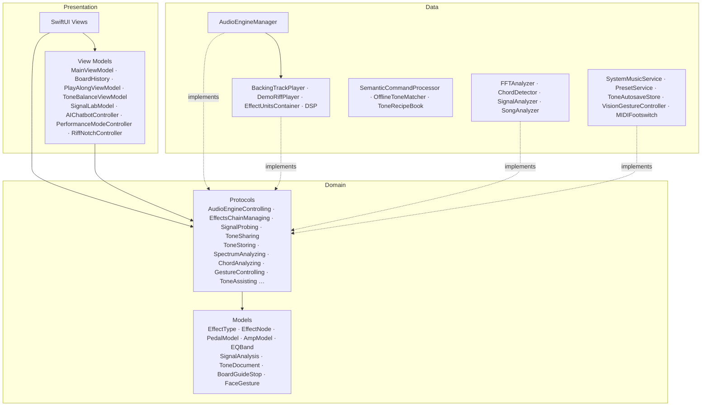

# RiffNode · 架構

<p><a href="ARCHITECTURE.md">English</a> · <b>繁體中文</b> · <a href="../README.zh-TW.md">← README</a></p>

RiffNode 是怎麼做的：分層方式、音訊如何保持即時安全，以及如何測試。

## 架構

RiffNode 採用 **MVVM** 與 **Clean Architecture**。依賴方向一律向內：Presentation 和 Data 都只依賴 Domain，彼此不依賴對方的具體型別。



```
RiffNode.swiftpm/
├── App/                    AppDependencies（只持有 protocol）與 live() 工廠（組合根，唯一會寫出
│                           Data 具體型別的地方），以及 ContentView（Welcome → Tour → Main）
├── Domain/                 純 Swift（只用 Foundation）
│   ├── Models/             效果器、經典踏板與音箱、preset、EQ、訊號分析、音色檔、
│   │                       踏板盤導覽、手勢，以及小型純規則（踏板順序、套用型號）
│   └── Protocols/          一個能力一個 protocol：音訊（引擎、踏板鏈、EQ、擷取、分享…）、
│                           互動（分析、手勢、Tone Assistant）與學習
├── Data/
│   ├── Audio/              AudioEngineManager（音訊圖）依職責拆成擴充檔（+AmpAndInput、
│   │                       +ChainSync、+PedalUnits、+SignalProbe…）· 播放器 · EffectUnitsContainer · DSP/
│   ├── Analysis/           FFTAnalyzer、ChordDetector、SignalProbe、SignalAnalyzer、SongAnalyzer
│   ├── AI/                 SemanticCommandProcessor、OfflineToneMatcher、ToneRecipeBook、ToneModels
│   ├── Playback/ · MIDI/ · Vision/ · Presets/（含自動儲存）· Learning/ · Logging
├── Presentation/
│   ├── ViewModels/         各功能的 view model + EngineRequirements（每個畫面能用什麼）
│   ├── Views/              一個功能一個資料夾：Main、Pedalboard、Performance、EQ、Learn、AI…
│   └── DesignSystem/       Tokens、玻璃卡片、按鈕、旋鈕、分頁列、背景、版面、DomainColors
└── Core/Extensions/
```

- **介面隔離** —— 引擎拆成多個小的能力 protocol。每個畫面在 `EngineRequirements` 宣告它需要什麼（例如 `SignalLabEngine = AudioEngineControlling & DemoRiffPlaying & SignalProbing & EffectsChainManaging`），所以 View 碰不到其他功能。
- **依賴反轉** —— View 與 view model 持有的是 `any …` protocol 型別。`AppDependencies` 只持有 protocol；它的 `live()` 工廠方法獨立成一個檔案，是唯一會寫出 Data 層具體型別的地方（預覽也透過它取得）。所以 `MainViewModel` 在測試裡可以用假的實作來跑，不需要音訊引擎、相機或 MIDI；`BoardHistory` 也只把踏板盤看成 `ToneSharing`、把儲存看成 `ToneStoring`。
- **不依賴 UI 的 Domain** —— 顏色放在 `Presentation/DesignSystem/DomainColors.swift`，AVFoundation 的對應放在 `Data`，所以 `Domain` 只 import Foundation。
- **單一職責** —— 伴奏、demo riff、效果器 unit、訊號分析、離線音色比對都是各自的型別；功能規則（切換模式時停止什麼、Tone balance 的遲滯判斷、復原）放在 view model，踏板盤規則（套用經典踏板、踏板順序建議）放在 Domain —— View 只負責呈現與轉交使用者的意圖。
- **開放封閉** —— 新增一顆經典踏板或音箱只是新增資料（一筆帶聲音參數與外觀的 `PedalModel`／`AmpVoice`），DSP 與繪圖程式都不用改。

## 實作重點

- **Swift 6 的音訊 tap** —— tap block 是全域、非隔離的函式，寫入有鎖保護的緩衝區，所以音訊執行緒上永遠不會跑到 `@MainActor` 的 closure。
- **啟動不卡頓** —— `AVAudioSession` 的啟用放在主執行緒之外。
- **Demo riff 與 groove** —— Karplus–Strong 撥弦合成（all-pass 校正音準、濾波過的撥弦雜訊、悶音 ghost note），加上合成的大鼓、小鼓、hi-hat 和貝斯，都用固定種子在裝置上產生；App 不內含任何音檔；Demo 匯入的 clean 錄音與 Play Along 的歌曲會用 `AVAudioConverter` 轉成引擎的取樣率。
- **即時 DSP** —— 自製的 `AUAudioUnit` 在音訊執行緒上原地處理，不配置記憶體、不用鎖；旋鈕數值透過 `Synchronization.Atomic` 跨執行緒傳遞。音箱的濾波器係數與喇叭箱 IR 在主執行緒寫進兩組緩衝區的其中一組；音訊執行緒會先標記自己正在讀哪一組、再確認它仍是目前那組，所以主執行緒不會改寫正在被讀的那組，即使同一個音訊區塊內連續改兩次設定也一樣。壓力測試在讀取端同時運作下切換 20 萬次，確認沒有任何一次讀到寫到一半的資料。
- **低延遲** —— I/O buffer 約 5 ms（48 kHz 下 256 個取樣）；Settings 顯示實測的來回延遲（輸入＋輸出延遲＋兩個 buffer），輸出為藍牙時提醒會多 100–200 ms。踏板一直接在圖上，以 `shouldBypassEffect` 切換，開關時不重建音訊圖。
- **實測的效能餘裕** —— `scripts/bench-audio.sh` 以 128 個取樣的 buffer 渲染一個有 11 個 DSP 階段的踏板盤（輸入級、wah、三顆破音、四顆調變、類比延遲、音箱）。在 M1 Pro 上約為即時速度的 59 倍（單核心的 1.7%）；加上一個標準 A1 NAM 擷取模型約再多 5%（即時速度的 20 倍）。就算是第 99.9 百分位的 buffer，也只用掉 2.67 ms 預算中不到 0.5 ms。
- **主執行緒保持空閒** —— 音高與和弦偵測在 main actor 之外執行（以 `vDSP_dotpr` 向量化）；每次結果帶有世代編號，重設或切換音源後才完成的舊結果會被丟棄，不會覆蓋新狀態。FFT 緩衝區只配置一次，不是每一幀配置。
- **乾淨的削波** —— overdrive、distortion、fuzz 的削波以 4 倍 oversampling 運算，超過 Nyquist 的諧波不會折回成刺耳的 aliasing。
- **喇叭箱 IR** —— 載入的檔案用 `AVAudioConverter` 重新取樣、截成 2048 tap、依峰值正規化，再用 `vDSP_conv` 卷積。
- **快速的裝置端 AI** —— 模型只填一個小小的 `@Generable` 輪廓（風格、gain、空間感、最多三顆代表性踏板），而不是直接給旋鈕數值；每次請求使用預熱過的新 session，在 macOS 27 的模型上約 3.5 秒回應，且不會超出 4K 的 context window。

## 測試

在裝有 Xcode 的 Mac 執行 `scripts/test-core.sh`，驗證音高、FFT、電平、AI 參數修改、舊訊息快照與免麥克風 setup。`scripts/test-audio.sh` 以離線音訊圖驗證 44.1／48 kHz 的 clean／加踏板差異、原創合成 riff，以及高競爭下的係數緩衝區交接。`scripts/test-viewmodels.sh` 用假的實作驗證 `MainViewModel`：腳踏開關事件、頭部手勢、preset 循環切換、取樣率傳遞、還原上次的踏板盤，以及 Learn 試聽不會進入復原紀錄。設定 `RIFFNODE_TEST_RECORDING` 為自己的 WAV，就能用自己的錄音跑音訊檢查。`scripts/bench-audio.sh [capture.nam]` 會量測 DSP 佔即時預算的比例。
